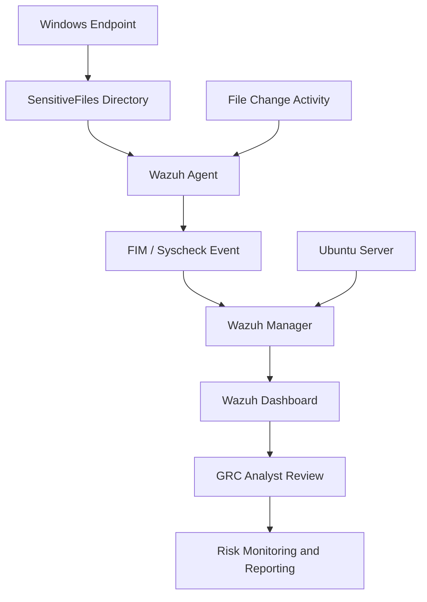

# INTERNATIONAL CYBERSECURITY AND DIGITAL FORENSICS ACADEMY

# GRC103 – RISK ASSESSMENT AND MANAGEMENT TECHNIQUES

## MODULE 4: RISK MONITORING AND REPORTING

### ROLE: GRC ANALYST

# LAB 1: PRACTICAL RISK MONITORING WITH WAZUH
## File Integrity Monitoring (FIM) Implementation and Control Verification Report

**Practical Risk Assessment Workshop**

---

# REPORT INFORMATION

| Field | Details |
|---|---|
| Student Name | Olubunmi Adesanmi |
| Registration Number | C11/CGRCE/26/17550 |
| Academy | International Cybersecurity and Digital Forensics Academy |
| Course | GRC103 – Risk Assessment and Management Techniques |
| Module | Module 4 – Risk Monitoring and Reporting |
| Laboratory | Lab 1 – Practical Risk Monitoring with Wazuh |
| Role | GRC Analyst |
| Submission Date | 22 November 2026 |
| Report Version | 1.0 |
| Environment | Ubuntu Server VM, Kali Linux VM and Windows endpoint |

---

# TABLE OF CONTENTS

- [Executive Summary](#executive-summary)
- [1. Introduction, Purpose and Scope](#1-introduction-purpose-and-scope)
  - [1.1 Purpose](#11-purpose)
  - [1.2 Scope](#12-scope)
  - [1.3 Learning Objectives](#13-learning-objectives)
- [2. Business Scenario and Risk Statement](#2-business-scenario-and-risk-statement)
  - [2.1 Potential Business Impact](#21-potential-business-impact)
- [3. Laboratory Architecture and Environment](#3-laboratory-architecture-and-environment)
  - [3.1 Environment Details](#31-environment-details)
  - [3.2 Prerequisites](#32-prerequisites)
- [4. Implementation and Configuration](#4-implementation-and-configuration)
  - [4.1 Deploying the Wazuh Manager on Ubuntu](#41-deploying-the-wazuh-manager-on-ubuntu)
  - [4.2 Accessing the Wazuh Dashboard](#42-accessing-the-wazuh-dashboard)
  - [4.3 Installing the Windows Agent](#43-installing-the-windows-agent)
  - [4.4 Registering the Agent with the Manager](#44-registering-the-agent-with-the-manager)
  - [4.5 Configuring File Integrity Monitoring](#45-configuring-file-integrity-monitoring)
  - [4.6 Generating Controlled Test Events](#46-generating-controlled-test-events)
- [5. Control Verification and Results](#5-control-verification-and-results)
  - [5.1 Test Plan and Expected Evidence](#51-test-plan-and-expected-evidence)
  - [5.2 Timestamped Test Log](#52-timestamped-test-log)
  - [5.3 Alert Review Record](#53-alert-review-record)
  - [5.4 Evidence Register](#54-evidence-register)
- [6. GRC Workshop and Analysis](#6-grc-workshop-and-analysis)
  - [6.1 Risk Identification and Business Impact](#61-risk-identification-and-business-impact)
  - [6.2 How FIM Alerts Help Quantify Risk](#62-how-fim-alerts-help-quantify-risk)
  - [6.3 Preventive Controls](#63-preventive-controls)
  - [6.4 Corrective Controls and Response Actions](#64-corrective-controls-and-response-actions)
  - [6.5 Management Metrics](#65-management-metrics)
  - [6.6 Centralised Monitoring, Governance and Auditability](#66-centralised-monitoring-governance-and-auditability)
  - [6.7 Compliance Mapping and Audit Evidence](#67-compliance-mapping-and-audit-evidence)
  - [6.8 Demonstrating File Integrity to an Auditor](#68-demonstrating-file-integrity-to-an-auditor)
- [7. Control Effectiveness Assessment](#7-control-effectiveness-assessment)
  - [7.1 Control Design Assessment](#71-control-design-assessment)
  - [7.2 Operating Effectiveness Assessment](#72-operating-effectiveness-assessment)
  - [7.3 Overall Control Conclusion](#73-overall-control-conclusion)
- [8. Recommendations and Action Plan](#8-recommendations-and-action-plan)
- [9. Limitations, Assumptions and Lessons Learned](#9-limitations-assumptions-and-lessons-learned)
  - [9.1 Lessons Learned](#91-lessons-learned)
- [10. Conclusion](#10-conclusion)
- [11. Submission Checklist](#11-submission-checklist)
- [12. References](#12-references)
- [13. OpenAI Usage Declaration](#13-openai-usage-declaration)
- [Appendix A – Final Lab Information](#appendix-a--final-lab-information)

---

# EXECUTIVE SUMMARY

This report documents the implementation approach and Governance, Risk and Compliance (GRC) evaluation of a File Integrity Monitoring (FIM) detective control using the Wazuh security monitoring platform.

The practical scenario addresses the risk of unauthorised modification or deletion of sensitive financial forecast documents on a Windows workstation. Financial forecast documents are important business information assets because they support budgeting, cash-flow planning, resource allocation and management decision-making.

The proposed risk treatment involves implementing continuous monitoring of a designated Windows directory, centrally collecting file-change events and generating alerts that can be reviewed for risk management, security investigation and audit purposes.

The laboratory architecture places the Wazuh Manager and Dashboard on an Ubuntu Server virtual machine running in Oracle VirtualBox. A Wazuh Agent is installed on the Windows endpoint. The agent is configured to monitor:

`C:\Users\[WindowsUsername]\SensitiveFiles`

Real-time File Integrity Monitoring is configured to observe activities involving files within this directory.

Three controlled activities are used to evaluate the control:

1. Creation of a dummy financial forecast document.
2. Modification of the dummy document.
3. Deletion of the dummy document.

The resulting `syscheck` events are reviewed in the Wazuh Dashboard. Event timestamps, agent details, file paths, event types and available checksum information are recorded for verification.

From a GRC perspective, the practical demonstrates how a technical security control can support the risk management lifecycle through continuous monitoring, evidence collection, investigation and management reporting.

The principal GRC conclusion is that File Integrity Monitoring is a **detective control**. It provides visibility into monitored file changes but does not independently prevent a user or process from making those changes.

A generated alert is an indicator requiring investigation, not automatic proof of unauthorised activity. Each event must be validated against approved changes, business-owner confirmation and relevant access records.

The final assessment of operating effectiveness must be supported by actual laboratory evidence, including installation verification, agent connectivity, configuration screenshots, the three controlled test results and the completed timestamped test log.

---

# 1. INTRODUCTION, PURPOSE AND SCOPE

## 1.1 Purpose

The purpose of this practical is to operationalise an identified information security risk by implementing a technical detective control through the Wazuh security monitoring platform.

The exercise demonstrates how endpoint monitoring can support the risk management lifecycle by identifying file changes, recording relevant event information and making monitoring evidence available through a central dashboard.

As a GRC Analyst, the objective is not limited to installing a security tool. It also involves understanding the business risk being addressed, verifying that the control operates as intended, evaluating its limitations and determining how the monitoring information can support governance and management decisions.

The practical connects technical implementation with:

- Risk identification and treatment.
- Security control implementation.
- Control verification and testing.
- Continuous risk monitoring.
- Security event investigation.
- Management reporting.
- Audit evidence and accountability.

## 1.2 Scope

The scope of this laboratory is limited to an Ubuntu-based Wazuh monitoring platform, one Windows endpoint, one designated test directory and fictional test documents.

The report covers deployment, dashboard access, agent installation and registration, File Integrity Monitoring configuration, controlled testing, alert review, control evaluation, management metrics and compliance evidence.

### In Scope

- Deployment of the Wazuh Manager and Dashboard on Ubuntu Server.
- Installation and registration of the Windows Agent.
- Configuration of real-time monitoring.
- Monitoring the designated `SensitiveFiles` directory.
- File creation, modification and deletion activities.
- Centralised security event review.
- Recording timestamps and file paths.
- Reviewing checksums where supplied by the alerts.
- GRC evaluation and management reporting.

### Out of Scope

- Monitoring actual confidential financial forecasts.
- Testing on production endpoints.
- Determining user intent from an alert alone.
- Implementing a complete enterprise prevention platform.
- Performing a full digital forensic investigation.
- Establishing compliance certification through Wazuh alone.

### Monitored Directory

```text
C:\Users\[WindowsUsername]\SensitiveFiles
```

Only dummy documents created for the practical should be stored in this directory.

## 1.3 Learning Objectives

The practical aims to demonstrate the ability to:

1. Deploy and access the Wazuh monitoring platform on Ubuntu.
2. Install and register a Windows Wazuh Agent.
3. Verify agent connectivity and operational status.
4. Configure real-time File Integrity Monitoring.
5. Generate controlled file creation, modification and deletion activities.
6. Investigate corresponding `syscheck` events.
7. Evaluate the effectiveness and limitations of a detective control.
8. Identify complementary preventive and corrective controls.
9. Define management metrics for risk monitoring.
10. Explain the governance, compliance and audit value of centralised monitoring.

---

# 2. BUSINESS SCENARIO AND RISK STATEMENT

A risk assessment identified unauthorised modification or deletion of sensitive financial forecast documents as a medium-to-high risk to the organisation.

Financial forecasts support business planning, budgeting, cash-flow management, resource allocation and management decision-making.

Unauthorised changes to these documents could compromise the integrity, accuracy and availability of the organisation's financial information.

### Risk Statement

If an unauthorised user or process modifies or deletes financial forecast documents on a key workstation, the organisation may make decisions using inaccurate information, lose access to important records, incur financial losses and experience operational, reputational or compliance consequences.

### Risk Assessment Summary

| Risk Element | Assessment |
|---|---|
| Risk Reference | [Insert risk register ID, if available] |
| Information Asset | Financial forecast documents stored on a Windows endpoint |
| Threat Event | Unauthorised or inappropriate creation, modification or deletion of forecast files |
| Potential Weakness | Excessive file permissions, compromised credentials, inadequate change approval, accidental editing or malicious activity |
| Initial Risk Rating | Medium-to-high, as stated in the instructor scenario |
| Approved Treatment | Implement a detective monitoring control using Wazuh FIM |
| Control Owner | [Insert responsible role or department] |
| Residual Risk | To be reassessed after monitoring coverage and test results are verified |

## 2.1 Potential Business Impact

Unauthorised changes to financial forecast documents could affect different areas of the organisation.

| Impact Area | Potential Consequence |
|---|---|
| Financial | Incorrect forecasts may lead to poor budgeting, cash-flow decisions, investment choices or resource allocation. Recovery and investigation may also create additional costs. |
| Operational | Finance teams may work from inaccurate or unavailable files. Reporting may be delayed, and management decisions may need to be corrected or repeated. |
| Reputational | Management, investors, lenders, customers or business partners may lose confidence in the reliability of the organisation's financial information. |
| Governance and Compliance | The organisation may be unable to demonstrate who changed important information, whether a change was approved or whether records remained reliable. |
| Legal and Assurance | Depending on the organisation and applicable obligations, unreliable financial records may create audit findings, disputes or regulatory scrutiny. |

The seriousness of the risk depends on the importance of the affected document, the extent of the change, whether the document was relied upon, the duration of the exposure and the organisation's ability to restore a trustworthy version.

---

# 3. LABORATORY ARCHITECTURE AND ENVIRONMENT

The practical uses a manager-agent monitoring architecture.

The Ubuntu Server virtual machine hosts the Wazuh Manager and Dashboard. The Windows endpoint runs the Wazuh Agent and contains the folder selected for monitoring.

The instructor-provided laboratory brief specifies Bridged Adapter networking so that the Ubuntu virtual machine and Windows endpoint can communicate over the same network.

## 3.1 Laboratory Architecture

| Component | Host / Platform | Purpose |
|---|---|---|
| Wazuh Manager | Ubuntu Server VM | Receives, processes and analyses monitoring events from the endpoint. |
| Wazuh Dashboard | Ubuntu Server VM | Provides a central interface for reviewing security events. |
| Wazuh Agent | Windows endpoint | Monitors the designated directory and forwards relevant events to the manager. |
| SensitiveFiles Folder | Windows endpoint | Dedicated test location containing dummy documents. |
| VirtualBox | Host computer | Provides the virtualised environment for Ubuntu Server. |
| Kali Linux VM | VirtualBox | Available laboratory security workstation, if required by the wider practical environment. |

### Monitoring Workflow



## 3.2 Environment Details

The following information should be completed using the actual configuration of the laboratory environment.

| Item | Actual Value |
|---|---|
| Physical Host Operating System | [Insert Windows edition and build] |
| Virtualisation Software | Oracle VirtualBox [Insert version] |
| Ubuntu Server | [Insert version/release] |
| Wazuh Platform | [Insert installed version] |
| Wazuh Windows Agent | [Insert installed version] |
| Ubuntu VM IP Address | [Insert actual IP address] |
| Windows Endpoint IP Address | [Insert actual IP address] |
| Network Adapter | Bridged Adapter / [Actual configuration] |
| Agent Name | [Insert configured name] |
| Agent ID | [Insert displayed ID] |
| Monitored Folder | `C:\Users\[WindowsUsername]\SensitiveFiles` |
| Test Period | [Insert start and end timestamps with timezone] |

## 3.3 Prerequisites

The following prerequisites apply to the laboratory:

1. Oracle VirtualBox installed.
2. An Ubuntu Server virtual machine available.
3. Ubuntu VM configured with the required network connectivity.
4. Administrative access to the Windows endpoint.
5. A Windows environment capable of running the Wazuh Agent.
6. Internet access where required for installation.
7. A dedicated `SensitiveFiles` folder.
8. Dummy documents for controlled testing.
9. A browser to access the Wazuh Dashboard.
10. Sufficient permissions to review agent status and security events.

### Security and Privacy Considerations

Only fictional laboratory documents should be monitored.

Real financial forecasts and confidential business records must not be used in this exercise.

Dashboard passwords, agent registration keys, private credentials and other secrets must be concealed in all screenshots and supporting documentation.

Access to the monitoring platform and laboratory systems should be restricted to authorised users.

---

# 4. IMPLEMENTATION AND CONFIGURATION

## 4.1 Deploying the Wazuh Manager on Ubuntu

The Wazuh platform is deployed on the Ubuntu Server virtual machine using the installation resources specified in the instructor-provided laboratory brief.

The laboratory uses the all-in-one installation approach, placing the central Wazuh components on a single server.

### Step 1: Import the Wazuh Repository Public Key

The instructor brief provides the following command:

```bash
curl -s https://packages.wazuh.com/key/GPG-KEY-WAZUH | sudo gpg --dearmor -o /usr/share/keyrings/wazuh-archive-keyring.gpg
```

### Step 2: Download the Wazuh Installation Assistant

```bash
curl -sO https://packages.wazuh.com/4.12/wazuh-install.sh
```

### Step 3: Run the Installation Assistant

The installation command specified in the instructor brief is:

```bash
sudo bash ./wazuh-install.sh -a -i
```

The `-a` option selects the all-in-one installation approach.

The `-i` option should not be interpreted as interactive mode. It is associated with bypassing minimum hardware requirement checks in applicable installer versions. Follow the instructor's exact installation instructions and check the script help before using optional switches.

The installation process should be monitored for completion messages and errors.

The generated dashboard credentials must be stored securely. They must not be copied into this report or exposed in evidence screenshots.

### Step 4: Verify the Wazuh Manager Service

Use:

```bash
sudo systemctl status wazuh-manager
```

Additional service commands:

Start the manager:

```bash
sudo systemctl start wazuh-manager
```

Stop the manager:

```bash
sudo systemctl stop wazuh-manager
```

Restart the manager:

```bash
sudo systemctl restart wazuh-manager
```

### Installation Verification Record

| Verification Item | Actual Result |
|---|---|
| Installation Date and Time | [Insert] |
| Installation Command Completed | [Yes / No] |
| Installation Message | [Insert observed message] |
| Manager Service Status | [Insert actual status] |
| Errors Encountered | [Insert observed errors or None] |
| Evidence Reference | E-01 / E-02 |

**Actual installation outcome:** [Complete from laboratory evidence.]

---

## 4.2 Accessing the Wazuh Dashboard

The Wazuh Dashboard provides a central interface for viewing security events, monitoring agent status and reviewing File Integrity Monitoring activities.

### Step 1: Identify the Ubuntu VM IP Address

On the Ubuntu Server terminal, run:

```bash
ip addr show
```

Identify the IP address assigned to the active network interface.

Alternatively:

```bash
hostname -I
```

Record the actual IP address.

### Step 2: Open the Dashboard

From a browser with access to the laboratory network, navigate to:

```text
https://[UBUNTU_VM_IP_ADDRESS]
```

### Step 3: Authenticate

Sign in using the credentials generated during the Wazuh installation.

The instructor brief identifies `admin` as the default username. Use the actual account details supplied by the installer.

A browser security warning may appear because the laboratory installation can use a self-signed certificate.

Before proceeding, verify that the address is the intended laboratory server.

### Dashboard Verification Record

| Verification Item | Actual Result |
|---|---|
| Dashboard IP Address | [Insert actual IP] |
| Dashboard URL | `https://[UBUNTU_VM_IP_ADDRESS]` |
| Date and Time Accessed | [Insert] |
| Dashboard Loaded | [Yes / No] |
| Authentication Successful | [Yes / No] |
| Screenshot | E-01 |

**Actual dashboard verification:** [Record what was observed.]

---

## 4.3 Installing the Windows Agent

The Wazuh Agent is installed on the Windows endpoint that contains the designated test folder.

The agent is responsible for monitoring the selected directory and forwarding relevant events to the Wazuh Manager.

### Step 1: Download the Windows Installer

The instructor brief specifies the following Wazuh Windows Agent installer:

https://packages.wazuh.com/4.x/windows/wazuh-agent-4.12.0-1.msi

### Step 2: Run the Installer

1. Locate the downloaded MSI installer.
2. Right-click the installer.
3. Select the installation option.
4. Follow the installation prompts.
5. Retain the default installation location unless the instructor requires otherwise.

The default directory specified in the brief is:

```text
C:\Program Files (x86)\ossec-agent\
```

### Step 3: Verify Installation

Confirm that the Wazuh Agent installation directory exists.

Record the actual installed version using the Windows installation details or the available agent information.

### Installation Record

| Item | Actual Result |
|---|---|
| Installer Downloaded | [Yes / No] |
| Installation Completed | [Yes / No] |
| Installation Version | [Insert] |
| Installation Directory | `C:\Program Files (x86)\ossec-agent\` |
| Installation Date and Time | [Insert] |
| Evidence Reference | [Insert] |

---

## 4.4 Registering the Agent with the Manager

Agent registration establishes communication between the Windows endpoint and the Wazuh Manager.

### Step 1: Open Agent Management on Ubuntu

Run:

```bash
sudo /var/ossec/bin/manage_agents
```

### Step 2: Add a New Agent

Follow the menu instructions:

1. Select `A` to add a new agent.
2. Enter a descriptive agent name.

Example:

```text
Finance-Dept-Workstation
```

3. For the agent IP address, follow the instructor's instruction. The value `any` may be appropriate for the laboratory configuration.
4. Confirm the agent entry.
5. Select `E` to extract the registration key.

### Step 3: Protect the Registration Key

Copy the generated key securely.

The registration key is sensitive information and must not be included in screenshots, GitHub repositories or the submitted report.

### Step 4: Configure the Windows Agent

On Windows:

1. Open the Wazuh Agent Manager.
2. Navigate to the Management tab.
3. Enter the extracted agent key into the appropriate field.
4. Enter the Ubuntu VM IP address as the Manager address.
5. Apply the configuration.
6. Restart the Windows Agent.

### Step 5: Verify Agent Connectivity

Open the Wazuh Dashboard.

Navigate to:

**Agents**

Locate the registered Windows endpoint.

The expected status specified in the instructor brief is:

```text
Active
```

### Agent Verification Record

| Item | Actual Result |
|---|---|
| Agent Name | [Insert] |
| Agent ID | [Insert] |
| Manager IP | [Insert] |
| Agent Registration Successful | [Yes / No] |
| Agent Status | [Active / Disconnected / Never connected / Other] |
| Date and Time Verified | [Insert] |
| Evidence Reference | E-03 |

The final report must reflect the status actually displayed in the dashboard.

---

## 4.5 Configuring File Integrity Monitoring

File Integrity Monitoring is configured on the Windows Agent to monitor a designated directory in real time.

The objective is to detect changes involving files stored in the `SensitiveFiles` folder.

### Step 1: Identify the Windows Username

The monitoring path must contain the actual Windows profile folder name.

Example:

```text
C:\Users\YOUR_WINDOWS_USERNAME\SensitiveFiles
```

Replace `YOUR_WINDOWS_USERNAME` with the actual profile folder name.

### Step 2: Create the SensitiveFiles Folder

Create the directory if it does not already exist.

Example:

```text
C:\Users\YOUR_WINDOWS_USERNAME\SensitiveFiles
```

Confirm that the path is correct before configuring the agent.

### Step 3: Locate the Agent Configuration File

Open the following directory:

```text
C:\Program Files (x86)\ossec-agent\
```

Locate:

```text
ossec.conf
```

Open the file using an editor with Administrator privileges.

### Step 4: Locate the Existing syscheck Section

Find the existing:

```xml
<syscheck>
```

section.

Insert the monitoring directory entry inside the existing section.

Example configuration:

```xml
<syscheck>
    <directories realtime="yes">C:\Users\YOUR_WINDOWS_USERNAME\SensitiveFiles</directories>
</syscheck>
```

The example is a configuration template. The actual Windows username and directory must be used.

Do not unnecessarily create a duplicate `<syscheck>` section if one already exists.

### Step 5: Save the Configuration

Save the modified `ossec.conf` file.

Verify that:

- The folder exists.
- The configured path matches the actual Windows directory.
- The `realtime="yes"` attribute is present.
- The directory entry is inside the appropriate `syscheck` section.

### Step 6: Restart the Windows Agent

Restart the Wazuh Agent using the Agent Manager interface or Windows Services.

The PowerShell method is:

```powershell
Restart-Service -Name wazuh
```

Run PowerShell with the required administrative permissions.

### FIM Configuration Verification

| Verification Item | Actual Result |
|---|---|
| SensitiveFiles Folder Created | [Yes / No] |
| Configuration File Modified | [Yes / No] |
| Correct Directory Configured | [Yes / No] |
| Realtime Attribute Added | [Yes / No] |
| Configuration Saved | [Yes / No] |
| Agent Restarted | [Yes / No] |
| Evidence Reference | E-04 |

**Configuration outcome:** [Record the actual result.]

---

## 4.6 Generating Controlled Test Events

After configuring FIM, three controlled activities are performed to establish whether the monitoring control detects changes within the designated directory.

Only dummy files should be used.

The sample filename specified in the instructor brief is:

```text
Q4_Financial_Forecast.docx
```

### Test 1: File Creation

1. Navigate to the monitored `SensitiveFiles` directory.
2. Create a new dummy document.
3. Name it `Q4_Financial_Forecast.docx`.
4. Record the exact date and time of creation.
5. Open the Wazuh Dashboard.
6. Navigate to Security Events.
7. Search for the corresponding `syscheck` event.

**Expected evidence:**

A file-added or file-created event showing the monitored file path and an event timestamp.

Record the alert only after verifying that it corresponds to the test document.

### Test 2: File Modification

1. Open the dummy document.
2. Add a test phrase, such as:

```text
Laboratory modification test - [date/time]
```

3. Save the document.
4. Record the exact modification time.
5. Return to the Wazuh Dashboard.
6. Search for the corresponding `syscheck` event.
7. Review the file path, timestamp and checksum information where available.

**Expected evidence:**

A file-modified event showing the affected file and its relevant change information.

### Test 3: File Deletion

1. Navigate to the monitored directory.
2. Locate `Q4_Financial_Forecast.docx`.
3. Delete the dummy document.
4. Record the exact date and time of deletion.
5. Open the Wazuh Dashboard.
6. Search for the corresponding `syscheck` event.

**Expected evidence:**

A file-deleted event identifying the monitored file and the relevant event timestamp.

### Test Execution Record

| Test ID | Activity | Actual Date and Time | Dashboard Result |
|---|---|---|---|
| FIM-01 | Create dummy document | [Insert] | [Insert] |
| FIM-02 | Modify dummy document | [Insert] | [Insert] |
| FIM-03 | Delete dummy document | [Insert] | [Insert] |

---

# 5. CONTROL VERIFICATION AND RESULTS

This section evaluates whether the configured FIM control produces the expected monitoring events.

Results must be based on the actual dashboard events and supporting evidence collected during the practical.

## 5.1 Test Plan and Expected Evidence

The following test plan provides the basis for evaluating the detective control.

| Test ID | Controlled Action | Expected FIM Evidence | Actual Outcome |
|---|---|---|---|
| FIM-01 | Create `Q4_Financial_Forecast.docx` | Syscheck event identifying the added file and its path | [Pass / Fail / Not tested – explain] |
| FIM-02 | Modify and save the dummy document | Syscheck event identifying modification and changed file attributes or checksum information where available | [Pass / Fail / Not tested – explain] |
| FIM-03 | Delete the dummy document | Syscheck event identifying the deleted file and its path | [Pass / Fail / Not tested – explain] |

### Test Result Definitions

- **Pass:** The expected event was observed and matched the controlled action.
- **Fail:** The expected event was not observed after the test and appropriate verification.
- **Not Tested:** The test was not performed.
- **Inconclusive:** An event was observed, but available evidence was insufficient to confirm the test result.

Do not mark a test as successful without supporting evidence.

## 5.2 Timestamped Test Log

The test log records the difference between the time a file activity occurred and the time the corresponding event became available in the dashboard.

All timestamps should use a consistent timezone.

For this practical, use SAST (UTC+2), unless another timezone was used.

| Test ID | Action Time | Dashboard Alert Time | Observed Event / Alert ID | Evidence Filename |
|---|---|---|---|---|
| FIM-01 | [YYYY-MM-DD HH:MM:SS SAST] | [Insert] | [Added / Event ID] | E05_File_Created_Alert.png |
| FIM-02 | [YYYY-MM-DD HH:MM:SS SAST] | [Insert] | [Modified / Event ID] | E06_File_Modified_Alert.png |
| FIM-03 | [YYYY-MM-DD HH:MM:SS SAST] | [Insert] | [Deleted / Event ID] | E07_File_Deleted_Alert.png |

### Alert Detection Delay

Where reliable timestamps are available, detection delay can be calculated as:

```text
Detection Delay = Dashboard Alert Time - File Activity Time
```

The result should be recorded in seconds or minutes.

Do not calculate a detection delay where the timestamps are unavailable, inconsistent or recorded in different timezones.

## 5.3 Alert Review Record

Each detected event should be reviewed to determine whether the information is sufficient for investigation.

| Field | Information to Record |
|---|---|
| Agent | Actual agent name and ID shown in the alert |
| File Path | Full path of the affected file |
| Event Type | Added, modified or deleted |
| Timestamp | Date, time and timezone |
| Checksum / Hash | Available checksum values, including SHA-256 where supplied |
| Alert Identifier | Actual alert ID, if available |
| Review Decision | Approved, unauthorised, benign/expected or unresolved |
| Supporting Evidence | Change approval, owner confirmation or other supporting records |

### Important Interpretation

A FIM alert confirms that the monitoring system observed an event involving a monitored file.

It does not independently establish:

- The identity of the person who initiated the change.
- Whether the action was authorised.
- Whether the action was malicious.
- The business reason for the activity.

The alert must be correlated with other relevant evidence before a final investigation decision is made.

## 5.4 Evidence Register

The evidence register tracks the supporting screenshots and records required for the practical.

| Evidence ID | Required Evidence | Suggested Filename | Status |
|---|---|---|---|
| E-01 | Ubuntu platform details and successful dashboard access | `E01_Ubuntu_Dashboard.png` | [Pending / Attached] |
| E-02 | Wazuh version and manager service status | `E02_Wazuh_Version_Service.png` | [Pending / Attached] |
| E-03 | Windows Agent listed as Active | `E03_Windows_Agent_Active.png` | [Pending / Attached] |
| E-04 | Monitored folder path and configuration excerpt | `E04_FIM_Configuration.png` | [Pending / Attached] |
| E-05 | File creation alert | `E05_File_Created_Alert.png` | [Pending / Attached] |
| E-06 | File modification alert | `E06_File_Modified_Alert.png` | [Pending / Attached] |
| E-07 | File deletion alert | `E07_File_Deleted_Alert.png` | [Pending / Attached] |
| E-08 | Completed timestamped test log and final event filter | `E08_Test_Log_and_Syscheck_Filter.png` | [Pending / Attached] |

### Evidence Handling Requirements

Each screenshot should:

1. Show the relevant laboratory activity or dashboard result.
2. Be readable and clearly labelled.
3. Include the relevant date and time where available.
4. Avoid exposing passwords, registration keys or other secrets.
5. Match the activity being described in the report.
6. Be stored using its corresponding evidence filename.

The evidence register must reflect the actual files attached to the submission.

---

# 6. GRC WORKSHOP AND ANALYSIS

## 6.1 Risk Identification and Business Impact

The practical addresses the risk of unauthorised changes to financial forecast documents.

These documents form part of the organisation's information assets because they support financial planning, cash-flow projections, budgeting and management decisions.

If a user or process changes important forecast information without proper authorisation, the organisation may make decisions using incorrect information.

For example, an unauthorised change to projected revenue, operating expenses or cash-flow assumptions could influence:

- Budget allocation.
- Procurement decisions.
- Staffing plans.
- Investment decisions.
- Financial reporting.
- Business performance assessments.

Deletion of important financial forecast documents may also affect information availability and create additional work for the finance team.

The organisation may need to reconstruct deleted information, investigate the event, restore a verified backup and correct decisions made using unreliable information.

The consequences may extend beyond the affected document itself.

Potential impacts include financial losses, operational disruption, reputational damage, management accountability issues and audit findings.

The seriousness of the risk depends on the importance of the document, the nature of the change, the duration of exposure, whether management relied on the information and the organisation's ability to recover a trustworthy version.

## 6.2 How FIM Alerts Help Quantify Risk

File Integrity Monitoring provides observable information about file-change activities within a monitored directory.

By recording file additions, modifications and deletions, the organisation can establish a baseline of normal file activity and identify unusual changes over time.

FIM monitoring information can support risk quantification in several ways.

### 1. Measuring File-Change Frequency

The organisation can count added, modified and deleted events during a reporting period.

This helps identify increases in file activity and potential unusual patterns.

### 2. Identifying Unusual Activity

An unexpected increase in deletion or modification events may indicate an operational issue, unauthorised activity or a change in business processes.

The activity should be investigated rather than automatically classified as a security incident.

### 3. Understanding Monitoring Coverage

FIM alerts must be interpreted alongside agent-health information.

A low alert count does not automatically indicate low risk if the monitored endpoint was disconnected or the relevant directory was not correctly configured.

### 4. Supporting Investigation

Timestamps help establish when file changes were observed.

File paths identify the affected objects, while available checksums can help compare file states.

### 5. Improving Risk Reporting

Trend information can support management reporting by highlighting changes in the frequency and nature of file activities.

### Important GRC Consideration

Alert counts are not equivalent to the number of confirmed security incidents.

Normal business activity, approved changes, automated processes and testing activities can all generate FIM events.

Each event should therefore be reviewed against:

- Approved change records.
- Business-owner confirmation.
- User and access records where available.
- Relevant incident reports.
- The criticality of the affected document.

To estimate risk accurately, event frequency should be considered alongside the number and criticality of monitored files, confirmed unauthorised changes, business impact and recovery outcomes.

## 6.3 Preventive Controls

File Integrity Monitoring is a detective control. It does not independently prevent users or processes from changing files.

A complementary preventive control is Role-Based Access Control (RBAC), supported by the principle of least privilege.

### Recommended Preventive Measures

**1. Role-Based Access Control**

Access should be assigned according to employees' responsibilities.

Only approved finance personnel should receive write permissions to sensitive forecast documents.

Other employees may receive read-only access where appropriate.

**2. Least-Privilege Access**

Users should receive only the minimum permissions necessary to perform their duties.

Unnecessary write permissions should be removed.

**3. Periodic Access Reviews**

Access to the financial forecast directory should be reviewed regularly.

Permissions should be updated when employees change roles or leave the organisation.

**4. Formal Change Approval**

Material changes to financial forecasts should follow a documented approval process.

The organisation should maintain records identifying:

- The requested change.
- The responsible individual.
- The approval authority.
- The date of approval.
- The business justification.

**5. Multi-Factor Authentication**

MFA can reduce the risk of unauthorised access resulting from compromised credentials.

**6. Protected Backups and Version History**

Protected backups and version history help restore trustworthy documents when inappropriate changes or deletion occur.

These controls complement FIM by reducing the likelihood of unauthorised changes and improving recovery capability.

## 6.4 Corrective Controls and Response Actions

A corrective control focuses on restoring an acceptable security state after an unwanted event has occurred.

For example, Wazuh may generate a modification alert for a financial forecast document outside the approved finance change window.

The alert should initiate a documented response process.

### Recommended Response Process

**Step 1: Alert Identification**

The GRC or security analyst identifies the relevant FIM alert.

The analyst records the affected agent, file path, event type and timestamp.

**Step 2: Evidence Preservation**

Relevant alert information and supporting records are preserved.

The analyst ensures that investigation evidence is not unnecessarily altered or lost.

**Step 3: Event Validation**

The activity is compared with the approved change calendar, change ticket and document-owner confirmation.

The analyst determines whether the activity was approved, accidental, automated, suspicious or unresolved.

**Step 4: Escalation**

If an unauthorised change is suspected or confirmed, the issue is escalated to the appropriate manager and security team.

**Step 5: Containment**

Where necessary, the organisation may suspend the suspected account, revoke active sessions or restrict access to the affected directory.

These actions should be authorised and proportionate to the risk.

**Step 6: Recovery**

The organisation may restore a verified clean version from a protected backup or version history.

The restored document should be checked before it is returned to business use.

**Step 7: Documentation and Improvement**

The incident, investigation, corrective actions and final outcome should be recorded.

Where an underlying weakness is identified, the organisation should improve access controls, approval processes or monitoring procedures.

### Important Consideration

An alert alone does not prove wrongdoing.

The organisation must validate whether the activity was authorised, accidental, automated or malicious before making containment or disciplinary decisions.

## 6.5 Management Metrics

Management metrics help determine whether the monitoring control continues to operate effectively.

The following three metrics are recommended.

### Metric 1: FIM Event Volume and Trend

| Attribute | Description |
|---|---|
| Metric | FIM Event Volume and Trend |
| Measurement | Count `syscheck` events during a defined reporting period. |
| Categories | Added, modified and deleted |
| Reporting Frequency | Weekly or monthly |
| Data Source | Wazuh Dashboard |
| Management Purpose | Identifies changes in file activity and unusual patterns. |

Management can compare event totals across reporting periods and investigate significant increases.

A higher number of events does not necessarily indicate a security incident. The events must be classified and investigated.

### Metric 2: Monitoring Coverage and Agent Health

| Attribute | Description |
|---|---|
| Metric | Monitoring Coverage and Agent Health |
| Measurement | Active monitored agents divided by total in-scope endpoints, multiplied by 100. |
| Formula | `(Active Monitored Agents / Total In-Scope Endpoints) × 100` |
| Reporting Frequency | Continuous monitoring with periodic reporting |
| Data Source | Wazuh Dashboard |
| Management Purpose | Demonstrates whether the monitoring control is connected and operational. |

For a single-endpoint laboratory, the expected monitoring scope is one Windows endpoint.

The actual result should state whether the expected agent remained Active during the test period.

The percentage must be calculated using observed agent status, not assumed availability.

### Metric 3: Unapproved Events and Response Performance

| Attribute | Description |
|---|---|
| Metric | Unapproved Events and Response Performance |
| Measurement | Count events confirmed as unauthorised or unresolved after investigation. |
| Supporting Information | Acknowledgement, investigation and closure timestamps |
| Data Source | Wazuh alerts and incident register |
| Reporting Frequency | Monthly or according to the incident reporting cycle |
| Management Purpose | Measures inappropriate activity and the organisation's response performance. |

Response performance may be measured using:

```text
Time to Acknowledge = Acknowledgement Time - Alert Time
```

```text
Time to Close = Incident Closure Time - Alert Time
```

These measurements should use consistent timestamps and a documented incident-handling process.

### Management Reporting Requirements

Each management metric should identify:

- Reporting period.
- Monitoring scope.
- Data source.
- Responsible owner.
- Target or expected performance.
- Actual result.
- Explanation of significant changes.
- Corrective action where required.

A dashboard figure without supporting context may be misleading.

For example, a low event count is only meaningful if the relevant agents were active and the intended directories were monitored throughout the reporting period.

## 6.6 Centralised Monitoring, Governance and Auditability

Centralising endpoint events in Wazuh provides authorised analysts with a consistent platform for reviewing activity across monitored systems.

Instead of relying exclusively on manually collected records from individual workstations, analysts can use the central dashboard to investigate events.

This improves the organisation's ability to:

- Review monitoring activity.
- Search events by agent and date.
- Identify affected file paths.
- Compare file-change activity.
- Investigate unusual behaviour.
- Support periodic reporting.
- Maintain evidence for audit purposes.

### Governance Benefits

**1. Accountability**

Centralised records can help demonstrate that file-change activity is being monitored.

**2. Auditability**

Event information can be reviewed alongside change approvals, incident records and corrective actions.

**3. Consistency**

The same monitoring platform and review approach can be applied across multiple in-scope endpoints.

**4. Risk Visibility**

Management can gain better visibility into patterns of file-change activity and monitoring coverage.

**5. Investigation Support**

Relevant event details can assist security teams in reconstructing the sequence of observed activities.

### Limitations

Centralisation alone does not guarantee:

- Complete monitoring coverage.
- Accurate event collection.
- Tamper-proof evidence.
- Appropriate log retention.
- Successful investigation.
- Compliance with every applicable requirement.

Governance value depends on correct configuration, reliable connectivity, access restrictions, time synchronisation, retention settings, regular review and documented responsibilities.

## 6.7 Compliance Mapping and Audit Evidence

The instructor brief references compliance expectations associated with frameworks and regulations such as:

- Sarbanes-Oxley Act (SOX).
- Payment Card Industry Data Security Standard (PCI DSS).
- Health Insurance Portability and Accountability Act (HIPAA).

Where an organisation is subject to relevant requirements, File Integrity Monitoring can support audit activities by providing technical evidence that designated files or directories were monitored and by recording observed file-change activities.

### How Wazuh FIM Can Support Assurance Activities

| Assurance Area | Potential Supporting Evidence |
|---|---|
| Security Monitoring | FIM configuration and monitored directory |
| File Integrity | File-change events and available checksums |
| Access Accountability | Agent identity and supporting access records |
| Change Management | Correlation of FIM alerts with approved change records |
| Incident Management | Alert investigation and escalation records |
| Audit Trail | Centralised events and documented review evidence |
| Risk Monitoring | Event trends, coverage and response metrics |

### Important Compliance Consideration

Wazuh does not automatically certify an organisation's compliance with SOX, PCI DSS, HIPAA or any other regulatory framework.

The organisation must determine which obligations apply, define its systems and information assets in scope, maintain appropriate access and change controls, retain evidence for the required period and demonstrate that monitoring alerts are reviewed and acted upon.

FIM should therefore be viewed as one technical control supporting a broader governance and compliance programme.

## 6.8 Demonstrating File Integrity to an Auditor

An auditor may ask the organisation to demonstrate that a particular sensitive file was not altered during a defined reporting period, such as the previous quarter.

The GRC Analyst should use a structured evidence-based approach.

### Step 1: Identify the File

Identify the exact file name and path.

Confirm that the file belongs to the approved monitoring scope.

### Step 2: Verify Monitoring Coverage

Confirm that the relevant Wazuh Agent remained active throughout the reporting period.

Review the agent's health and connectivity records.

### Step 3: Verify FIM Configuration

Confirm that the specific directory was configured for monitoring during the entire period.

Review configuration evidence and any historical configuration changes.

### Step 4: Review Monitoring Events

Open the Wazuh Dashboard.

Filter the available `syscheck` events by:

- Relevant agent.
- Specific file path.
- Reporting period.
- Relevant event types.

### Step 5: Review Event History

Identify whether matching modification or deletion events were recorded.

Retain the dashboard search results, timestamps and available file information.

### Step 6: Corroborate the Evidence

Where available, compare:

- Initial file checksum.
- Final file checksum.
- Protected version history.
- Approved change records.
- Relevant access logs.
- Backup and recovery records.

### Step 7: Report the Conclusion Carefully

If no matching change events are identified, the conclusion should be:

> No change events for the specified file were recorded by the configured monitoring control during the defined reporting period, subject to verified monitoring coverage, configuration and event-retention limitations.

The analyst should not claim that the file was definitely never altered simply because the dashboard returned no matching events.

Any gap in agent connectivity, configuration, monitoring coverage, time synchronisation or retention must be disclosed to the auditor.

This approach demonstrates the importance of combining technical evidence with governance records and independent verification.

---

# 7. CONTROL EFFECTIVENESS ASSESSMENT

This section evaluates the design and operating effectiveness of the proposed Wazuh FIM control.

The assessment distinguishes between whether the control is appropriately designed and whether it actually operated as intended during the practical.

## 7.1 Control Design Assessment

The proposed FIM control is appropriate for the stated detective objective.

Its design identifies:

- A specific Windows endpoint.
- A designated monitoring directory.
- Real-time monitoring.
- Centralised event collection.
- A dashboard for alert review.
- Controlled file activities for testing.

The control is intended to detect creation, modification and deletion activities involving files in the monitored directory.

In a production environment, the design should be expanded to include all relevant financial forecast locations and additional monitoring requirements.

These should include:

- Documented control ownership.
- Access governance.
- Alert classification and handling.
- Log retention.
- Periodic configuration reviews.
- Incident escalation procedures.
- Management reporting.

## 7.2 Operating Effectiveness Assessment

Operating effectiveness must be based on actual evidence collected during the practical.

The assessment should confirm that:

1. The Wazuh Manager was successfully installed.
2. The dashboard was accessible.
3. The Windows Agent was registered and connected.
4. The correct monitoring directory was configured.
5. The agent was operational during the test.
6. All three controlled file activities generated corresponding events.
7. Alert details were sufficient for investigation.
8. Any delays, errors or limitations were recorded.

### Operating Effectiveness Test Matrix

| Control Test Criterion | Assessment Result | Evidence |
|---|---|---|
| Wazuh Manager installed and operational | [Pass / Fail / Not tested] | E-01 / E-02 |
| Dashboard accessible by authorised user | [Pass / Fail / Not tested] | E-01 |
| Windows Agent registered and Active | [Pass / Fail / Not tested] | E-03 |
| Correct SensitiveFiles path configured | [Pass / Fail / Not tested] | E-04 |
| Creation event detected | [Pass / Fail / Not tested] | E-05 |
| Modification event detected | [Pass / Fail / Not tested] | E-06 |
| Deletion event detected | [Pass / Fail / Not tested] | E-07 |
| Alerts contain relevant path and timestamp information | [Pass / Fail / Not tested] | E-05 / E-06 / E-07 |
| Timestamped test log completed | [Pass / Fail / Not tested] | E-08 |

### Operating Effectiveness Considerations

A technically correct configuration does not automatically demonstrate operating effectiveness.

The control must be tested and the resulting alerts reviewed.

Any missing events, incorrect folder paths, disconnected agents, incomplete alert information or monitoring gaps must be documented.

## 7.3 Overall Control Conclusion

### Final Control Rating

**[Effective / Partially Effective / Ineffective / Not Yet Assessed]**

### Basis for Rating

[Insert a summary of the actual deployment evidence, agent health, configuration verification, results of the three tests, alert quality, event timing and identified limitations.]

### Assessment Rationale

The Wazuh FIM implementation should be treated as a detective monitoring layer.

It improves visibility and supports investigation of file changes within the configured directory.

However, the control does not prevent users or processes from changing the files.

Residual risk may remain where:

- Users retain inappropriate write permissions.
- Monitoring coverage is incomplete.
- The agent becomes disconnected.
- The monitored path is incorrectly configured.
- Alerts are not reviewed promptly.
- Event retention is insufficient.
- Backups are unavailable or have not been tested.

The final rating must be justified by actual evidence rather than the intended design or expected test outcome.

---

# 8. RECOMMENDATIONS AND ACTION PLAN

The following recommendations strengthen the overall control environment and address weaknesses that may remain even after FIM implementation.

| Ref. | Recommendation | Control Type | Suggested Owner | Priority |
|---|---|---|---|---|
| R-01 | Apply least-privilege permissions to the financial forecast folder. Restrict write access to approved finance roles and review access periodically. | Preventive | IT / Data Owner | High |
| R-02 | Require documented approval for material changes to financial forecast documents and retain approval records. | Preventive / Governance | Finance Manager | High |
| R-03 | Maintain protected, versioned backups and periodically test restoration of forecast documents. | Corrective / Recovery | IT Operations | High |
| R-04 | Establish an alert-triage process with severity classifications, response owners, escalation paths and response time targets. | Detective / Corrective | Security Operations | High |
| R-05 | Review agent health, monitored paths and FIM configuration on a scheduled basis. Investigate monitoring gaps. | Monitoring | IT Security | High |
| R-06 | Retain FIM alerts and related incident records according to the organisation's approved retention requirements. Restrict access to monitoring records. | Governance | IT / Compliance | Medium |
| R-07 | Produce regular management reports showing FIM activity, agent coverage, confirmed unauthorised changes and response performance. | Reporting | GRC / Risk Owner | Medium |

### Recommended Action Plan

The organisation should assign a responsible owner and target completion date to each recommendation.

| Action | Responsible Owner | Target Date | Completion Status |
|---|---|---|---|
| Review folder permissions | IT / Data Owner | [Insert] | [Open / In Progress / Complete] |
| Establish change-approval procedure | Finance Manager | [Insert] | [Open / In Progress / Complete] |
| Verify backup and restoration capability | IT Operations | [Insert] | [Open / In Progress / Complete] |
| Document alert-response procedure | Security Operations | [Insert] | [Open / In Progress / Complete] |
| Establish periodic monitoring review | IT Security | [Insert] | [Open / In Progress / Complete] |
| Approve evidence-retention requirements | IT / Compliance | [Insert] | [Open / In Progress / Complete] |
| Implement management reporting | GRC / Risk Owner | [Insert] | [Open / In Progress / Complete] |

---

# 9. LIMITATIONS, ASSUMPTIONS AND LESSONS LEARNED

The following limitations and assumptions should be considered when interpreting the practical results.

1. This is a controlled academic laboratory using one Ubuntu virtual machine and one Windows endpoint. It does not demonstrate an enterprise-wide deployment.

2. The instructor brief specifies Bridged Adapter networking. Actual network settings and connectivity must be recorded from the student's environment.

3. The laboratory uses Wazuh 4.12 installation resources. Actual manager and agent versions must be verified and recorded.

4. FIM alerts indicate that a monitored file event was observed. They do not independently establish the identity, intention or authorisation status of the person or process responsible.

5. The absence of an alert does not prove that no file change occurred.

6. Monitoring coverage, agent health, configuration, event timing, retention and query filters must be reviewed before drawing conclusions.

7. The real-time monitoring configuration covers only the designated directory. Files outside that directory are not covered by this specific configuration.

8. A single-server all-in-one deployment introduces a concentration and availability risk when compared with a properly designed production architecture.

9. The practical does not independently establish compliance with SOX, PCI DSS, HIPAA or any other regulatory framework.

10. The final control effectiveness rating must depend on actual evidence collected during testing.

## 9.1 Lessons Learned

The practical demonstrates that technical monitoring is most valuable when connected to a defined business risk, a clear control objective and a repeatable response process.

Installing and configuring a monitoring platform is only part of the control implementation process.

The GRC Analyst must also understand:

- What information asset is being protected.
- What threat or risk the control addresses.
- Which assets and directories are within monitoring scope.
- Whether the agent is actively communicating with the manager.
- Whether expected file changes generate corresponding events.
- Whether monitoring evidence is complete and reliable.
- Whether events are approved or require investigation.
- How identified weaknesses should be addressed.

The practical also reinforces the importance of combining preventive, detective and corrective controls.

Preventive controls reduce the likelihood of inappropriate file changes. Detective controls identify and record monitored changes. Corrective controls support investigation, containment and recovery.

Together, these measures provide a more effective approach to managing information security risks.

---

# 10. CONCLUSION

The Wazuh File Integrity Monitoring practical provides a structured approach to monitoring changes involving sensitive financial forecast documents on a Windows endpoint and centralising the resulting evidence through an Ubuntu-hosted Wazuh platform.

The control supports risk monitoring by making file additions, modifications and deletions visible for investigation, verification and management reporting.

From a GRC perspective, the exercise demonstrates how technical controls can support organisational risk treatment and improve the availability of evidence for governance, accountability and audit activities.

However, FIM must be treated as a detective rather than a preventive control.

It does not independently stop unauthorised file modifications or deletion. The organisation should therefore complement monitoring with least-privilege access, strong authentication, documented change approval, protected backups, periodic access reviews and timely corrective action.

The overall effectiveness of the implementation depends on verified agent connectivity, accurate directory configuration, reliable event collection, appropriate retention and a documented process for reviewing and responding to alerts.

The final assessment of operating effectiveness must be based on actual laboratory results, including the Wazuh deployment evidence, agent status, configuration verification, three controlled test alerts and completed timestamped test log.

This practical reinforces that effective risk monitoring requires more than technology. It requires clear control ownership, reliable evidence, investigation procedures, management oversight and continuous improvement.

---

# 11. SUBMISSION CHECKLIST

The following checklist should be completed before submitting the final report.

| Requirement | Completed? | Evidence / Notes |
|---|---|---|
| Full name and registration number entered | [Yes / No] | Report Information |
| Software versions and laboratory architecture recorded | [Yes / No] | Sections 3 and Appendix A |
| Ubuntu platform and dashboard evidence attached | [Yes / No] | E-01 |
| Wazuh version and manager service status evidenced | [Yes / No] | E-02 |
| Windows Agent registration and Active status evidenced | [Yes / No] | E-03 |
| Monitored folder path and configuration excerpt evidenced | [Yes / No] | E-04 |
| File creation alert captured | [Yes / No] | E-05 |
| File modification alert captured | [Yes / No] | E-06 |
| File deletion alert captured | [Yes / No] | E-07 |
| Timestamped test log completed | [Yes / No] | E-08 |
| GRC analysis questions answered | [Yes / No] | Sections 6.1–6.8 |
| Three management metrics included | [Yes / No] | Section 6.5 |
| Recommendations and action plan included | [Yes / No] | Section 8 |
| Limitations and control rating addressed | [Yes / No] | Sections 7 and 9 |
| References included | [Yes / No] | Section 12 |
| OpenAI usage declaration included | [Yes / No] | Section 13 |
| All passwords, agent keys and secrets concealed | [Yes / No] | Final evidence review |
| All actual results verified against evidence | [Yes / No] | Final review |

---

# 12. REFERENCES

International Cybersecurity and Digital Forensics Academy. (n.d.). *GRC103: Risk assessment and management techniques – Module 4: Risk monitoring and reporting, Lab 1: Practical risk monitoring with Wazuh – File integrity monitoring* [Instructor-provided laboratory brief].

OpenAI. (2026). *ChatGPT* [Large language model]. https://chatgpt.com/

Wazuh, Inc. (n.d.-a). *Basic settings: File integrity monitoring (Wazuh 4.12 documentation).* https://documentation.wazuh.com/4.12/user-manual/capabilities/file-integrity/basic-settings.html

Wazuh, Inc. (n.d.-b). *Installing the Wazuh server using the assisted installation method (Wazuh 4.12 documentation).* https://documentation.wazuh.com/4.12/installation-guide/wazuh-server/installation-assistant.html

Wazuh, Inc. (n.d.-c). *Wazuh agent for Windows, version 4.12.0-1* [Software installer]. https://packages.wazuh.com/4.x/windows/wazuh-agent-4.12.0-1.msi

Wazuh, Inc. (n.d.-d). *Wazuh repository GPG public key* [Cryptographic public key]. https://packages.wazuh.com/key/GPG-KEY-WAZUH

Wazuh, Inc. (n.d.-e). *Wazuh installation assistant, version 4.12* [Installation script]. https://packages.wazuh.com/4.12/wazuh-install.sh

---

# 13. OPENAI USAGE DECLARATION

## AI Tool Used

**ChatGPT – OpenAI**

**Purpose of Use:** Report structuring, writing assistance, technical concept clarification, proofreading and reference formatting.

During the preparation of this report, ChatGPT, an AI language model developed by OpenAI, was used as a supporting tool to assist with organising the report, improving written clarity and grammar, explaining File Integrity Monitoring and GRC concepts, and structuring technical documentation.

The AI tool assisted with presenting the practical activities in a clear and professional format.

ChatGPT was not used to execute the practical laboratory activities, access the Ubuntu or Windows virtual machines, install or configure the Wazuh platform, perform file modification tests, capture screenshots or independently verify laboratory results.

All technical implementation details, environment configurations, IP addresses, timestamps, screenshots, test outcomes and final control effectiveness conclusions must be based on the student's actual laboratory activities and supporting evidence.

The student is responsible for reviewing the AI-assisted material, verifying technical information against appropriate documentation, validating all reported results and complying with the academic integrity requirements of the International Cybersecurity and Digital Forensics Academy.

The use of ChatGPT is acknowledged as a supporting learning and documentation resource. It does not replace the student's responsibility for understanding, performing and evaluating the practical work.

### AI Tool Reference

OpenAI. (2026). *ChatGPT* [Large language model]. https://chatgpt.com/

---

# APPENDIX A – FINAL LAB INFORMATION

The following table provides a consolidated record of the laboratory configuration.

| Field | Final Value |
|---|---|
| Student Name | Olubunmi Adesanmi |
| Registration Number | C11/CGRCE/26/17550 |
| Course | GRC103 – Risk Assessment and Management Techniques |
| Module | Module 4 – Risk Monitoring and Reporting |
| Laboratory | Lab 1 – Practical Risk Monitoring with Wazuh |
| Submission Date | 22 November 2026 |
| Ubuntu Version | [Insert actual version] |
| Wazuh Manager Version | [Insert actual version] |
| Wazuh Dashboard Version | [Insert actual version] |
| Windows Version | [Insert actual version] |
| Wazuh Agent Version | [Insert actual version] |
| VirtualBox Version | [Insert actual version] |
| Manager IP Address | [Insert actual IP] |
| Windows Endpoint IP Address | [Insert actual IP] |
| Agent Name | [Insert actual name] |
| Agent ID | [Insert actual ID] |
| Monitored Folder | [Insert exact path] |
| Lab Execution Date | [Insert actual date] |
| Timezone | SAST (UTC+2), or [actual timezone] |
| Final Control Rating | [Insert evidence-based rating] |

---


**Prepared by:** Olubunmi Adesanmi  
**Role:** GRC Analyst  
**Institution:** International Cybersecurity and Digital Forensics Academy  
**Course:** GRC103 – Risk Assessment and Management Techniques
