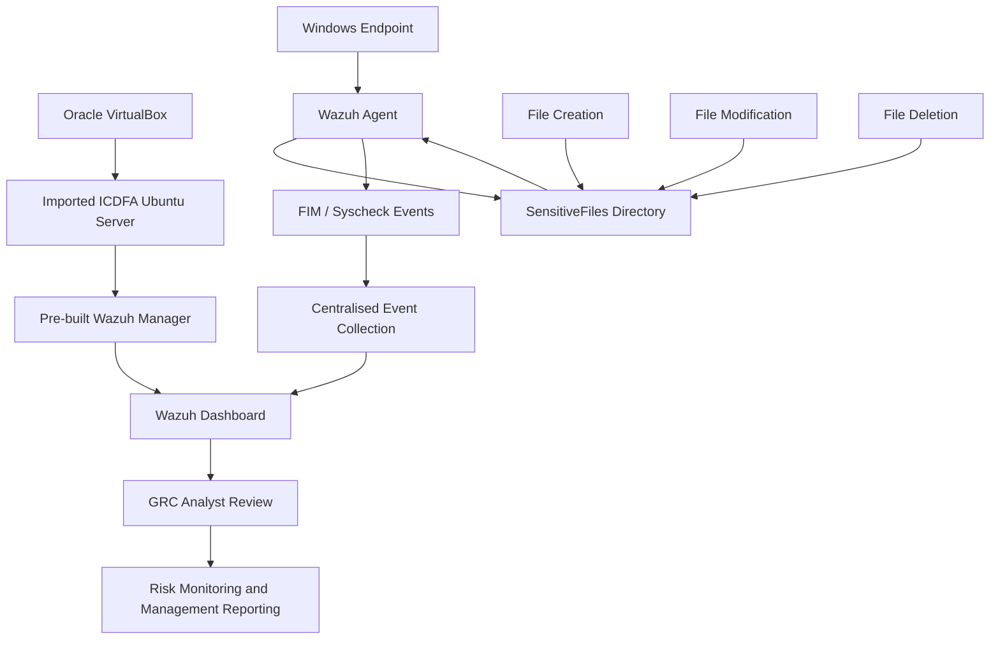

# INTERNATIONAL CYBERSECURITY AND DIGITAL FORENSICS ACADEMY

# GRC103 – RISK ASSESSMENT AND MANAGEMENT TECHNIQUES

## MODULE 4: RISK MONITORING AND REPORTING

### LAB 1: PRACTICAL RISK MONITORING WITH WAZUH
### File Integrity Monitoring (FIM) Implementation and Control Verification Report

**Role:** GRC Analyst  
**Practical Risk Assessment Workshop**

---

## REPORT INFORMATION

| Field | Details |
|---|---|
| Student Name | Olubunmi Adesanmi |
| Registration Number | C11/CGRCE/26/17550 |
| Institution | International Cybersecurity and Digital Forensics Academy |
| Course | GRC103 – Risk Assessment and Management Techniques |
| Module | Module 4 – Risk Monitoring and Reporting |
| Laboratory | Lab 1 – Practical Risk Monitoring with Wazuh |
| Role | GRC Analyst |
| Submission Date | 22 November 2026 |
| Report Version | 1.0 |
| Virtualisation Platform | Oracle VirtualBox |
| Monitoring Server | ICDFA-provided Ubuntu Server VM |
| Endpoint | Windows |
| Supplementary Environment | Kali Linux VM |
| Security Monitoring Platform | Wazuh |

---

# TABLE OF CONTENTS

- [1. Executive Summary](#1-executive-summary)
- [2. Introduction, Purpose and Scope](#2-introduction-purpose-and-scope)
  - [2.1 Purpose](#21-purpose)
  - [2.2 Scope](#22-scope)
  - [2.3 Learning Objectives](#23-learning-objectives)
- [3. Business Scenario and Risk Statement](#3-business-scenario-and-risk-statement)
  - [3.1 Risk Assessment Summary](#31-risk-assessment-summary)
  - [3.2 Potential Business Impact](#32-potential-business-impact)
- [4. Laboratory Architecture and Environment](#4-laboratory-architecture-and-environment)
  - [4.1 Laboratory Architecture](#41-laboratory-architecture)
  - [4.2 Environment Configuration](#42-environment-configuration)
  - [4.3 Security and Privacy Considerations](#43-security-and-privacy-considerations)
- [5. Implementation and Configuration](#5-implementation-and-configuration)
  - [5.1 Importing the Pre-Built ICDFA Wazuh Server](#51-importing-the-pre-built-icdfa-wazuh-server)
  - [5.2 Starting and Verifying the Wazuh Server](#52-starting-and-verifying-the-wazuh-server)
  - [5.3 Accessing the Wazuh Dashboard](#53-accessing-the-wazuh-dashboard)
  - [5.4 Installing the Windows Wazuh Agent](#54-installing-the-windows-wazuh-agent)
  - [5.5 Registering the Windows Agent](#55-registering-the-windows-agent)
  - [5.6 Configuring File Integrity Monitoring](#56-configuring-file-integrity-monitoring)
  - [5.7 Preparing the Monitored Directory](#57-preparing-the-monitored-directory)
- [6. Control Verification and Test Results](#6-control-verification-and-test-results)
  - [6.1 Test Methodology](#61-test-methodology)
  - [6.2 File Creation Test](#62-file-creation-test)
  - [6.3 File Modification Test](#63-file-modification-test)
  - [6.4 File Deletion Test](#64-file-deletion-test)
  - [6.5 Test Results Summary](#65-test-results-summary)
  - [6.6 Timestamped Test Log](#66-timestamped-test-log)
  - [6.7 Alert Review and Analysis](#67-alert-review-and-analysis)
  - [6.8 Evidence Register](#68-evidence-register)
- [7. GRC Workshop and Analysis](#7-grc-workshop-and-analysis)
  - [7.1 Risk Identification and Business Impact](#71-risk-identification-and-business-impact)
  - [7.2 How FIM Alerts Support Risk Quantification](#72-how-fim-alerts-support-risk-quantification)
  - [7.3 Preventive Controls](#73-preventive-controls)
  - [7.4 Corrective Controls and Response Actions](#74-corrective-controls-and-response-actions)
  - [7.5 Management Metrics](#75-management-metrics)
  - [7.6 Centralised Monitoring, Governance and Auditability](#76-centralised-monitoring-governance-and-auditability)
  - [7.7 Compliance Mapping and Audit Evidence](#77-compliance-mapping-and-audit-evidence)
  - [7.8 Demonstrating File Integrity to an Auditor](#78-demonstrating-file-integrity-to-an-auditor)
- [8. Control Effectiveness Assessment](#8-control-effectiveness-assessment)
  - [8.1 Control Design Assessment](#81-control-design-assessment)
  - [8.2 Operating Effectiveness Assessment](#82-operating-effectiveness-assessment)
  - [8.3 Residual Risk Assessment](#83-residual-risk-assessment)
  - [8.4 Overall Control Conclusion](#84-overall-control-conclusion)
- [9. Recommendations and Action Plan](#9-recommendations-and-action-plan)
- [10. Limitations, Assumptions and Lessons Learned](#10-limitations-assumptions-and-lessons-learned)
  - [10.1 Limitations](#101-limitations)
  - [10.2 Lessons Learned](#102-lessons-learned)
- [11. Conclusion](#11-conclusion)
- [12. Submission Checklist](#12-submission-checklist)
- [13. References](#13-references)
- [14. OpenAI Usage Declaration](#14-openai-usage-declaration)
- [Appendix A – Final Laboratory Information](#appendix-a--final-laboratory-information)

---

# 1. EXECUTIVE SUMMARY

This report documents the practical implementation, verification and Governance, Risk and Compliance (GRC) evaluation of a File Integrity Monitoring (FIM) detective control using the Wazuh security monitoring platform.

The practical addressed an identified information security risk involving the unauthorised modification or deletion of sensitive financial forecast documents stored on a Windows endpoint. Financial forecast documents are important organisational information assets because they support budgeting, cash-flow planning, resource allocation, financial reporting and management decision-making.

The laboratory environment consisted of an ICDFA-provided Ubuntu Server virtual machine, a Windows endpoint and a Kali Linux virtual machine. The Ubuntu Server was supplied with a pre-built Wazuh Manager environment and was imported into Oracle VirtualBox. Consequently, the practical involved importing, starting, accessing and verifying the existing Wazuh environment rather than performing a fresh installation of the Wazuh Manager.

A Windows Wazuh Agent was installed and registered with the central Wazuh Manager. The agent was configured to monitor a designated `SensitiveFiles` directory in real time.

The practical involved three controlled file activities using a fictional financial forecast document:

1. File creation.
2. File modification.
3. File deletion.

The corresponding monitoring events were examined through the Wazuh Dashboard, with attention to the affected file path, event type, timestamps, agent information and available checksum details.

From a GRC perspective, the practical demonstrated how technical security monitoring supports risk treatment by improving visibility into file-change activities, providing evidence for investigation and supporting management reporting.

The principal control conclusion is that File Integrity Monitoring is a **detective security control**. It identifies and reports changes involving monitored files but does not independently prevent unauthorised modifications or deletion.

A FIM alert is an indicator requiring investigation, not automatic proof of malicious or unauthorised activity. Events must be reviewed against approved changes, business-owner confirmation and other relevant security records.

The practical also highlighted the importance of monitoring coverage, agent health, accurate configuration, evidence retention and documented incident-response procedures.

The final assessment of operating effectiveness is based on the actual implementation evidence and the results recorded during the controlled tests.

---

# 2. INTRODUCTION, PURPOSE AND SCOPE

## 2.1 Purpose

The purpose of this practical was to implement and evaluate a technical detective security control through the Wazuh monitoring platform.

The exercise focused on monitoring changes to sensitive financial forecast documents stored within a designated Windows directory.

The implementation connected a central Wazuh Manager hosted on an imported ICDFA Ubuntu Server virtual machine with a Windows endpoint running the Wazuh Agent.

The practical demonstrated how file-change events could be identified at endpoint level, forwarded to a central monitoring platform and reviewed for security and governance purposes.

As a GRC Analyst, the objective extended beyond configuring a technical solution. It involved understanding the business risk being addressed, evaluating the control's purpose, examining the monitoring evidence and identifying how the control supports governance, risk management and auditability.

The exercise therefore connected technical implementation with:

- Risk identification and treatment.
- Security control implementation.
- Control verification and testing.
- Continuous risk monitoring.
- Security event investigation.
- Management reporting.
- Audit evidence and accountability.

## 2.2 Scope

The practical covered the following activities:

- Importing the ICDFA-provided Wazuh Server into Oracle VirtualBox.
- Starting and verifying the pre-built Wazuh Manager environment.
- Identifying the server's network address.
- Accessing the Wazuh Dashboard.
- Installing the Wazuh Agent on a Windows endpoint.
- Registering the Windows Agent with the Wazuh Manager.
- Configuring real-time File Integrity Monitoring.
- Monitoring the designated `SensitiveFiles` directory.
- Performing controlled file creation, modification and deletion activities.
- Reviewing corresponding `syscheck` events.
- Evaluating the detective control from a GRC perspective.
- Identifying complementary preventive and corrective controls.
- Developing management metrics and risk treatment recommendations.

### Monitored Directory

```text
C:\Users\[WindowsUsername]\SensitiveFiles
```

The actual Windows profile folder name was used when configuring the monitoring path.

Only fictional laboratory documents were used in the controlled tests.

### Scope Exclusions

The following activities were outside the scope of this practical:

- Monitoring real confidential financial forecast documents.
- Deploying Wazuh across an enterprise production environment.
- Establishing user identity or intent through a FIM alert alone.
- Performing a complete digital forensic investigation.
- Establishing compliance certification through Wazuh alone.

## 2.3 Learning Objectives

The practical addressed the following learning objectives:

1. Import and access an existing Wazuh monitoring environment.
2. Verify the availability of the Wazuh Manager and Dashboard.
3. Install and register a Windows Wazuh Agent.
4. Configure real-time File Integrity Monitoring.
5. Generate controlled file creation, modification and deletion activities.
6. Identify and review corresponding monitoring events.
7. Evaluate the design and operating effectiveness of a detective control.
8. Connect technical monitoring with organisational risk management.
9. Define management metrics for continuous risk monitoring.
10. Explain the governance, compliance and audit value of centralised monitoring.

---

# 3. BUSINESS SCENARIO AND RISK STATEMENT

The laboratory was based on an organisational scenario in which unauthorised modification or deletion of sensitive financial forecast documents had been identified as a medium-to-high information security risk.

Financial forecasts support important business activities, including budgeting, cash-flow management, resource allocation, investment decisions and management reporting.

Unauthorised changes to these documents could compromise the accuracy, integrity and availability of the organisation's financial information.

### Risk Statement

If an unauthorised user or process modifies or deletes financial forecast documents on a key workstation, the organisation may make decisions using inaccurate information, lose access to important records, incur financial losses and experience operational, reputational or compliance consequences.

## 3.1 Risk Assessment Summary

| Risk Element | Assessment |
|---|---|
| Risk Reference | [ risk register ID |
| Information Asset | Financial forecast documents stored on a Windows endpoint |
| Threat Event | Unauthorised or inappropriate creation, modification or deletion of forecast files |
| Potential Weakness | Excessive file permissions, compromised credentials, inadequate change approval, accidental editing or malicious activity |
| Initial Risk Rating | Medium-to-high, as identified in the instructor scenario |
| Approved Risk Treatment | Implement a detective monitoring control using Wazuh FIM |
| Control Owner | IT Security / Information Asset Owner |
| Residual Risk | To be reassessed following verification of monitoring coverage and control effectiveness |

## 3.2 Potential Business Impact

Unauthorised changes to financial forecast documents could affect multiple areas of the organisation.

| Impact Area | Potential Consequence |
|---|---|
| Financial | Incorrect forecasts could affect budgeting, cash-flow decisions, investment and resource allocation. Investigation and recovery could introduce additional costs. |
| Operational | Finance teams could use inaccurate information, experience reporting delays or need to reconstruct deleted documents. |
| Reputational | Management, investors, lenders, customers or business partners could lose confidence in the reliability of financial information. |
| Governance and Compliance | The organisation may be unable to demonstrate that changes to important financial records were appropriately authorised and monitored. |
| Legal and Assurance | Depending on applicable obligations, unreliable financial records may result in audit findings, disputes or regulatory scrutiny. |

The severity of the risk depends on the importance of the affected document, the nature of the change, the period of exposure, whether management relied on the information and the organisation's ability to recover a trustworthy version.

---

# 4. LABORATORY ARCHITECTURE AND ENVIRONMENT

The practical used a virtualised laboratory environment consisting of the ICDFA Wazuh Server, a Kali Linux virtual machine and a Windows endpoint.

The primary monitoring design followed the Wazuh Manager-Agent architecture.

The ICDFA-provided Ubuntu Server hosted the pre-built Wazuh Manager environment. The Windows endpoint ran the Wazuh Agent responsible for monitoring the designated directory and forwarding relevant events to the manager.

## 4.1 Laboratory Architecture

| Component | Platform | Purpose |
|---|---|---|
| ICDFA Wazuh Server | Ubuntu Server VM | Provided the pre-built central Wazuh monitoring environment. |
| Wazuh Manager | ICDFA Ubuntu Server | Received and processed endpoint monitoring events. |
| Wazuh Dashboard | Wazuh Server environment | Provided the interface for reviewing agents and security events. |
| Wazuh Agent | Windows endpoint | Monitored the designated directory and forwarded relevant events. |
| SensitiveFiles Directory | Windows endpoint | Contained dummy documents used for controlled FIM testing. |
| Kali Linux VM | Kali Linux | Supplementary laboratory workstation. |
| Oracle VirtualBox | Host computer | Hosted the imported ICDFA server and other laboratory virtual machines. |

### Monitoring Workflow



## 4.2 Environment Configuration

The laboratory used the following components.

| Item | Configuration |
|---|---|
| Virtualisation Platform | Oracle VirtualBox |
| Monitoring Server | ICDFA-provided Ubuntu Server VM |
| Server Deployment Method | Import of pre-built virtual machine |
| Wazuh Manager | Pre-installed on the supplied ICDFA server |
| Wazuh Dashboard | Provided within the Wazuh environment |
| Endpoint Operating System | Windows |
| Monitoring Agent | Wazuh Windows Agent |
| Supplementary VM | Kali Linux |
| Monitored Directory | `C:\Users\[WindowsUsername]\SensitiveFiles` |
| FIM Monitoring Mode | Real-time |
| Main Test Activities | File creation, modification and deletion |


## 4.3 Security and Privacy Considerations

The practical used fictional laboratory documents to avoid exposing confidential financial information.

Authentication credentials, agent registration keys and other secrets were treated as sensitive information and excluded from the report and supporting screenshots.

Access to the monitoring platform and laboratory systems was restricted to the authorised laboratory environment.

---

# 5. IMPLEMENTATION AND CONFIGURATION

## 5.1 Importing the Pre-Built ICDFA Wazuh Server

The laboratory used a Wazuh Server virtual machine supplied by the International Cybersecurity and Digital Forensics Academy.

The provided server contained a pre-built Wazuh Manager environment. It was imported into Oracle VirtualBox and used as the central monitoring platform for the practical.

This approach provided an existing monitoring environment and enabled the practical to focus on endpoint integration, FIM configuration, control verification and GRC analysis.

### Importation Process

The following activities were carried out:

1. The ICDFA-provided Wazuh Server virtual machine was obtained.
2. Oracle VirtualBox was opened.
3. The import function was used to import the supplied virtual machine.
4. The imported server was added to the VirtualBox environment.
5. The virtual machine was selected and started.
6. The Ubuntu Server environment was accessed.
7. The existing Wazuh Manager environment was checked before proceeding with endpoint integration.

### Deployment Method Clarification

The Wazuh Manager was already included in the pre-built ICDFA server.

Therefore, the practical did not involve downloading and installing Wazuh Manager from scratch using the installation script.

The work performed involved importing, starting, accessing and verifying the supplied Wazuh environment.

This distinction is important because the purpose of the practical was to implement and verify FIM using the provided monitoring infrastructure.

**Evidence:** Imported ICDFA Wazuh Server in Oracle VirtualBox.

## 5.2 Starting and Verifying the Wazuh Server

After importing the ICDFA virtual machine, the server was started through Oracle VirtualBox.

The Ubuntu Server terminal was accessed to verify the availability of the Wazuh Manager service.

The following command was used:

```bash
sudo systemctl status wazuh-manager
```

The command displayed the current service information and operational state.

Where necessary, the service could be controlled using:

```bash
sudo systemctl start wazuh-manager
```

```bash
sudo systemctl restart wazuh-manager
```

The server network configuration was also examined to identify the IP address assigned to the active network interface.

```bash
ip addr show
```

Alternatively:

```bash
hostname -I
```

The identified server IP address was required for dashboard access and Windows Agent communication.

### Server Verification Record

| Verification Item | Recorded Result |
|---|---|
| ICDFA Server Imported | Yes |
| Pre-built Wazuh Manager Provided | Yes |
| Virtual Machine Started | Running |
| Wazuh Manager Service | Active|
| Ubuntu Server IP Address | 10.181.93.69 |
| kali Linux IP Address  | 10.181.93.210 |


## 5.3 Accessing the Wazuh Dashboard

The Wazuh Dashboard provided the central interface for reviewing the monitoring environment.

Following identification of the Ubuntu Server IP address, the dashboard was accessed through a web browser firefox.

The access format was:

```text
https://10.181.93.69
```

The appropriate administrator credentials were used to authenticate.

After successful access, the dashboard was reviewed to confirm availability of the monitoring environment and its management interface.

The dashboard was subsequently used to review agent information and file-integrity events.


## 5.4 Installing the Windows Wazuh Agent

A Wazuh Agent was installed on the Windows endpoint selected for monitoring.

The agent provided the endpoint-level monitoring capability required to observe changes within the designated `SensitiveFiles` directory.

The instructor brief specified the following Windows installer:

https://packages.wazuh.com/4.x/windows/wazuh-agent-4.12.0-1.msi

The MSI installer was used to install the Wazuh Agent on the Windows endpoint.

The default installation directory specified in the instructor brief was:

```text
C:\Program Files (x86)\ossec-agent\
```

The configuration file used in the subsequent FIM setup was:

```text
C:\Program Files (x86)\ossec-agent\ossec.conf
```

## 5.5 Registering the Windows Agent

Following installation, the Windows Agent was registered with the Wazuh Manager.

Agent registration established the connection between the endpoint monitoring component and the central monitoring platform.

The Wazuh Manager's agent management utility was accessed using:

```bash
sudo /var/ossec/bin/manage_agents
```

The registration process involved:

1. Adding a new agent.
2. Providing a descriptive agent name.
3. Configuring the appropriate agent address setting.
4. Confirming the agent entry.
5. Extracting the registration key.
6. Entering the registration key into the Windows Agent management interface.
7. Entering the Ubuntu Server IP address as the Manager address.
8. Applying the configuration.
9. Restarting the Windows Agent.

The extracted registration key was treated as confidential and was not included in the report or public evidence.

### Agent Connectivity Verification

The Wazuh Dashboard was used to review the registered endpoint.

The actual agent status displayed by the dashboard was examined to determine whether communication with the manager had been established.


## 5.6 Configuring File Integrity Monitoring

After registering the Windows Agent, the configuration was updated to monitor the designated `SensitiveFiles` directory.

The objective was to enable real-time detection of file-change activities within the selected directory.

### Configuration File

The following configuration file was accessed:

```text
C:\Program Files (x86)\ossec-agent\ossec.conf
```

The existing `<syscheck>` section was located.

A directory-monitoring entry was added within the existing section.

```

The actual Windows profile name was substituted into the directory path.

The `realtime="yes"` attribute enabled real-time monitoring for the configured directory.

The configuration file was saved after modification.

The Windows Agent was restarted to apply the updated configuration.

Where PowerShell was used, the restart command was:

```powershell
Restart-Service -Name wazuh
```

## 5.7 Preparing the Monitored Directory

After configuring FIM, the designated `SensitiveFiles` directory was used for the controlled testing activities.

A dummy financial forecast document named:

```text
Q4_Financial_Forecast.docx
```

was used to represent a sensitive organisational financial document.

The document was fictional and did not contain actual organisational financial records.

The three file activities examined during the practical were:

- Creation of the dummy document.
- Modification and saving of the dummy document.
- Deletion of the dummy document.

These activities provided the basis for evaluating the configured monitoring control.

---

# 6. CONTROL VERIFICATION AND TEST RESULTS

The control verification phase examined whether the configured Wazuh FIM control detected file-change activities within the designated Windows directory.

Three controlled activities were performed, and their corresponding monitoring information was reviewed through the Wazuh Dashboard.

## 6.1 Test Methodology

The practical used a controlled testing methodology involving three file activities:

1. File creation.
2. File modification.
3. File deletion.

For each test, the corresponding file action was performed in the monitored directory.

The Wazuh Dashboard was then reviewed for the related `syscheck` event.

The following information was considered during event review:

- Agent name and ID.
- Affected file path.
- Event type.
- Event timestamp.
- Available file attributes.
- Checksum information where supplied.
- Correspondence between the action performed and the event generated.

The following classifications were used to assess individual tests:

| Status | Meaning |
|---|---|
| Pass | The expected monitoring event was observed and matched the controlled action. |
| Fail | The expected event was not observed after appropriate verification. |
| Inconclusive | An event was observed, but the available evidence was insufficient to confirm the result. |
| Not Tested | The corresponding activity was not performed. |

## 6.2 File Creation Test – FIM-01

The first controlled test examined whether Wazuh detected the creation of a new file within the monitored directory.

The following activity was performed:

1. The `SensitiveFiles` directory was accessed.
2. A new dummy document was created.
3. The document was named `Q4_Financial_Forecast.docx`.
4. The creation activity was recorded.
5. The Wazuh Dashboard was accessed.
6. Security Events were reviewed for the corresponding `syscheck` event.

The expected result was an event identifying the newly added file and its monitored directory path.

### File Creation Test Record

| Test Attribute | Result |
|---|---|
| Test ID | FIM-01 |
| Test Activity | File creation |
| Test File | Q4_Financial_Forecast.docx |

## 6.3 File Modification Test – FIM-02

The second controlled test examined whether Wazuh detected changes to an existing file.

The following activity was performed:

1. The dummy financial forecast document was opened.
2. A test phrase was added to the document.
3. The document was saved.
4. The modification time was recorded.
5. The Wazuh Dashboard was accessed.
6. The corresponding `syscheck` event was reviewed.

The expected result was a file-modification event identifying the affected document and relevant change information.

Where available, checksum information was examined to support the assessment of file-content changes.

### File Modification Test Record

| Test Attribute | Result |
|---|---|
| Test ID | FIM-02 |
| Test Activity | File modification |
| Test File | Q4_Financial_Forecast.docx |


## 6.4 File Deletion Test – FIM-03

The third controlled test examined whether Wazuh detected the deletion of the dummy financial forecast document.

The following activity was performed:

1. The monitored directory was accessed.
2. The `Q4_Financial_Forecast.docx` document was located.
3. The dummy document was deleted.
4. The deletion time was recorded.
5. The Wazuh Dashboard was accessed.
6. Security Events were reviewed for the corresponding `syscheck` event.

The expected result was an event identifying the deleted document and its associated monitoring information.

### File Deletion Test Record

| Test Attribute | Result |
|---|---|
| Test ID | FIM-03 |
| Test Activity | File deletion |
| Test File | Q4_Financial_Forecast.docx |


## 6.5 Alert Review and Analysis

The Wazuh Dashboard provided a central interface for reviewing monitoring events associated with the designated directory.

The event review considered the endpoint, affected file and nature of the observed change.

| Review Field | Information to Examine |
|---|---|
| Agent | Agent name and ID |
| File Path | Full path of the affected file |
| Event Type | Added, modified or deleted |
| Timestamp | Date and time of the event |
| Checksum / Hash | Available checksum information |
| Event Identifier | Relevant alert or event ID |
| Review Decision | Approved, unauthorised, benign/expected or unresolved |
| Supporting Evidence | Screenshot, change approval or other relevant record |

### GRC Interpretation

A FIM alert provides evidence that the monitoring system observed an event involving a monitored file.

It does not independently establish:

- The identity of the person responsible.
- Whether the change was authorised.
- Whether the activity was malicious.
- The business reason behind the activity.

The event must therefore be correlated with change-approval records, business-owner confirmation and other relevant security evidence.

This distinction is important because legitimate business operations can also generate FIM alerts.

---

# 7. GRC WORKSHOP AND ANALYSIS

## 7.1 Risk Identification and Business Impact

The practical addressed the risk of unauthorised modification or deletion of sensitive financial forecast documents.

Financial forecasts form part of the organisation's information assets because they support budgeting, cash-flow projections, financial planning and management decisions.

An unauthorised change to these records could compromise their accuracy and reliability.

For example, an alteration to projected revenue, operating expenses or cash-flow assumptions could affect decisions concerning staffing, procurement, financing, resource allocation and investment.

Deletion of important financial forecast documents could also affect information availability and require the finance team to reconstruct documents or restore earlier versions.

The potential business consequences extend beyond the affected file.

They may include financial losses, operational disruption, reputational damage, governance concerns and difficulties during audits.

The practical therefore demonstrated the importance of monitoring sensitive information assets and maintaining evidence of changes to them.

## 7.2 How FIM Alerts Support Risk Quantification

File Integrity Monitoring provides observable information about file-change activity within a designated directory.

This information can support risk assessment and monitoring by recording additions, modifications and deletions.

### Establishing a Baseline

The organisation can review normal file-change activity over time and establish a baseline of expected behaviour.

### Identifying Unusual Activity

Unexpected increases in modification or deletion events may indicate operational issues or possible security incidents.

The events require investigation before they can be classified.

### Measuring Monitoring Coverage

FIM alert information should be evaluated alongside agent health and connectivity.

A low alert count does not automatically demonstrate low risk where the endpoint was disconnected or the monitored directory was incorrectly configured.

### Supporting Investigation

Event timestamps, file paths and available checksums assist in identifying the affected file and examining the nature of the observed change.

### Improving Management Reporting

Event trends can support reporting by highlighting changes in file activity and monitoring coverage.

**Important GRC consideration:** FIM alert volume is not equivalent to the number of confirmed unauthorised incidents. Normal business activity, approved changes and automated processes may also produce alerts.

Events must be classified after investigation.

## 7.3 Preventive Controls

File Integrity Monitoring is a detective control. It identifies file changes but does not independently prevent users or processes from modifying files.

A complementary preventive control is Role-Based Access Control (RBAC), supported by the principle of least privilege.

### Recommended Preventive Measures

**1. Role-Based Access Control**

Access permissions should be assigned according to employees' responsibilities. Write permissions to the financial forecast directory should be restricted to approved finance personnel.

**2. Least-Privilege Access**

Users should receive only the permissions necessary to perform their responsibilities.

**3. Periodic Access Reviews**

Access should be reviewed regularly and adjusted when employees change roles or leave the organisation.

**4. Formal Change Approval**

Material changes to sensitive financial documents should follow a documented approval process.

The process should record the requested change, responsible person, approving authority, date and business justification.

**5. Multi-Factor Authentication**

MFA should be used to reduce the risk of unauthorised access resulting from compromised credentials.

**6. Protected Backups and Version History**

Protected backups and version history should be maintained to support recovery of trustworthy documents.

These measures complement FIM by reducing the likelihood of inappropriate changes and supporting recovery when changes occur.

## 7.4 Corrective Controls and Response Actions

Corrective controls help restore an acceptable security state after an unwanted event has occurred.

For example, Wazuh may generate a modification alert for a financial forecast document outside the approved change window.

The alert should initiate a documented investigation and response process.

| Step | Response Activity |
|---|---|
| 1. Identification | Identify the alert and record the affected agent, file path, event type and timestamp. |
| 2. Preservation | Preserve relevant monitoring evidence and supporting records. |
| 3. Validation | Compare the event with approved changes and obtain business-owner confirmation. |
| 4. Escalation | Escalate suspected or confirmed unauthorised activity to the appropriate team. |
| 5. Containment | Restrict inappropriate access or suspend a suspected account where justified and authorised. |
| 6. Recovery | Restore a verified clean version from a protected backup or version history where necessary. |
| 7. Documentation | Record the incident, investigation, recovery and corrective actions. |


## 7.5 Management Metrics

Management metrics help determine whether the monitoring control is operating as intended and whether alerts are being investigated appropriately.

Three principal metrics were identified.

### Metric 1: FIM Event Volume and Trend

| Attribute | Description |
|---|---|
| Metric | FIM Event Volume and Trend |
| Measurement | Number of `syscheck` events within a reporting period |
| Categories | Added, modified and deleted |
| Reporting Frequency | Weekly or monthly |
| Data Source | Wazuh Dashboard |
| Management Purpose | Identifies patterns in file-change activity and unusual increases. |

### Metric 2: Monitoring Coverage and Agent Health

| Attribute | Description |
|---|---|
| Metric | Monitoring Coverage and Agent Health |
| Measurement | Active monitored agents divided by total in-scope endpoints, multiplied by 100 |
| Formula | `(Active Monitored Agents / Total In-Scope Endpoints) × 100` |
| Data Source | Wazuh Dashboard |
| Management Purpose | Demonstrates whether monitoring is connected and operational. |

For this laboratory, the expected monitoring scope was one Windows endpoint. Its actual status must be supported by evidence from the dashboard.

### Metric 3: Unapproved Events and Response Performance

| Attribute | Description |
|---|---|
| Metric | Unapproved Events and Response Performance |
| Measurement | Number of confirmed unauthorised or unresolved events |
| Supporting Information | Alert, acknowledgement, investigation and closure timestamps |
| Data Source | Wazuh alerts and incident register |
| Management Purpose | Evaluates the effectiveness of investigation and response. |

Response performance is be calculated using:

```text
Time to Acknowledge = Acknowledgement Time - Alert Time
```

```text
Time to Close = Closure Time - Alert Time
```

### Management Reporting Requirements

Each metric should identify its reporting period, scope, data source, responsible owner, target, actual result and explanation of significant changes.

Dashboard information should always be interpreted alongside agent health and monitoring coverage.

## 7.6 Centralised Monitoring, Governance and Auditability

The central Wazuh monitoring environment provided a common interface for reviewing endpoint monitoring information.

Centralised monitoring supports governance by enabling authorised analysts to examine file-change events without relying entirely on manual collection of information from individual endpoints.

### Accountability

Monitoring records help demonstrate that relevant file activity was observed by the security monitoring platform.

### Auditability

Events can be reviewed alongside change approvals, incident records and corrective actions.

### Consistency

A central monitoring environment supports a consistent approach to reviewing events and preparing reports.

### Risk Visibility

Management can gain greater visibility into file-change activity and monitoring coverage.

### Investigation Support

Event details assist analysts in identifying affected files and reconstructing observed activities.

### Governance Limitations

Centralisation alone does not guarantee complete monitoring coverage or tamper-proof evidence.

Effective governance also depends on correct configuration, reliable connectivity, agent availability, appropriate access restrictions, time synchronisation, log retention and documented control ownership.

## 7.7 Compliance Mapping and Audit Evidence

The instructor-provided brief referenced compliance expectations associated with frameworks and regulations such as:

- Sarbanes-Oxley Act (SOX).
- Payment Card Industry Data Security Standard (PCI DSS).
- Health Insurance Portability and Accountability Act (HIPAA).

Where relevant obligations apply, File Integrity Monitoring can support assurance activities by providing technical evidence of monitored file changes.

| Assurance Area | Supporting Evidence |
|---|---|
| Security Monitoring | FIM configuration and directory scope |
| File Integrity | File-change events and available checksums |
| Access Accountability | Agent identity and supporting access records |
| Change Management | Correlation of alerts with approved changes |
| Incident Management | Alert investigation and escalation records |
| Audit Trail | Centralised events and documented review |
| Risk Monitoring | Event trends, coverage and response metrics |

Wazuh does not automatically certify an organisation's compliance with these frameworks or regulations.

The organisation must determine which obligations apply and demonstrate that the relevant governance and control requirements are addressed.

FIM should therefore be considered one technical control within a broader governance and compliance programme.


---

# 8. CONTROL EFFECTIVENESS ASSESSMENT

## 8.1 Control Design Assessment

The Wazuh FIM control was designed to address the identified risk of unauthorised modification or deletion of sensitive financial forecast documents.

The design included:

- A defined Windows monitoring endpoint.
- A designated `SensitiveFiles` directory.
- An installed Wazuh Agent.
- A central Wazuh Manager.
- Real-time file monitoring.
- Centralised event review.
- Controlled file-change activities.

This design was appropriate for the detective monitoring objective.

In a production environment, the control should be extended to cover all relevant financial forecast locations and supported by documented control ownership, access governance, alert procedures, evidence retention and periodic reviews.


The assessment considered both the successful implementation activities and any limitations identified during testing.

## 8.3 Residual Risk Assessment

Although FIM improves visibility into file-change activities, residual risk remains because it does not independently prevent changes.

Additional weaknesses may exist where:

- Users have excessive write permissions.
- The monitoring agent becomes disconnected.
- Sensitive directories are outside the monitoring scope.
- Alerts are not reviewed promptly.
- Evidence retention is insufficient.
- Backups are unavailable or have not been tested.
- Change approvals are not properly enforced.

Residual risk should therefore be assessed alongside the effectiveness of preventive, detective and corrective controls.

### Assessment Basis


The practical demonstrated how an existing Wazuh environment could be used to monitor sensitive files on a Windows endpoint and centralise the resulting monitoring information.

The effectiveness of the implemented detective control depended on accurate configuration, agent availability, reliable event collection and sufficient supporting evidence.

The control should not be treated as a standalone preventive measure. It must operate alongside access restrictions, change approvals, protected backups and appropriate incident-response procedures.

---

# 9. RECOMMENDATIONS AND ACTION PLAN

The following recommendations were identified to strengthen the overall control environment and address weaknesses that may remain after FIM implementation.

| Ref. | Recommendation | Control Type | Suggested Owner | Priority |
|---|---|---|---|---|
| R-01 | Apply least-privilege permissions to the financial forecast directory and restrict write access to approved finance roles. | Preventive | IT / Data Owner | High |
| R-02 | Introduce documented approval procedures for material changes to financial forecast documents. | Preventive / Governance | Finance Manager | High |
| R-03 | Maintain protected, versioned backups and periodically test restoration. | Corrective / Recovery | IT Operations | High |
| R-04 | Establish an alert-triage process with severity classifications, response owners and escalation procedures. | Detective / Corrective | Security Operations | High |
| R-05 | Review Wazuh agent health, monitored paths and FIM configuration periodically. | Monitoring | IT Security | High |
| R-06 | Define appropriate FIM alert retention and restrict access to monitoring records. | Governance | IT / Compliance | Medium |
| R-07 | Produce regular management reports covering FIM activity, monitoring coverage and response performance. | Reporting | GRC / Risk Owner | Medium |

### Recommended Action Tracking

| Action | Responsible Owner | 
|---|---|---|---|
| Review financial forecast folder permissions | IT / Data Owner | 
| Establish formal change approval | Finance Manager | 
| Verify backup and restoration capability | IT Operations | 
| Establish the alert-response procedure | Security Operations | 
| Review Wazuh agent health and monitoring coverage | IT Security | 
| Approve evidence-retention requirements | IT / Compliance | 
| Implement periodic management reporting | GRC / Risk Owner | 

---

# 10. LIMITATIONS, ASSUMPTIONS AND LESSONS LEARNED

## 10.1 Limitations

The following limitations were considered when evaluating the practical:

1. The exercise used an academic laboratory environment rather than an enterprise production deployment.

2. The Wazuh Manager was supplied as part of the pre-built ICDFA Ubuntu Server virtual machine. The practical involved importing and using that environment rather than performing a fresh Manager installation.

3. Monitoring was limited to one Windows endpoint and one designated directory.

4. A FIM alert identifies an observed file-change event but does not independently establish the identity or intention of the person or process responsible.

5. The absence of an alert does not prove that no modification or deletion occurred.

6. Monitoring coverage, agent health, configuration accuracy, event retention and timestamp consistency must be considered when interpreting results.

7. The configured monitoring path did not automatically cover files outside the designated directory.

8. The practical did not independently establish compliance certification under SOX, PCI DSS, HIPAA or other regulatory frameworks.

9. The final control rating depended on the accuracy and completeness of the supporting evidence.

## 10.2 Lessons Learned

The practical demonstrated the importance of connecting technical security monitoring with business risk and governance objectives.

Using the pre-built ICDFA Wazuh Server provided an existing central monitoring environment. Importing and verifying the server highlighted the importance of understanding the monitoring infrastructure before integrating endpoints.

The Windows Agent demonstrated the role of endpoint monitoring in providing visibility into file-change activities.

Configuring the `SensitiveFiles` directory illustrated the importance of clearly defining monitoring scope to ensure that the intended information assets are covered.

The controlled creation, modification and deletion activities provided a structured method for evaluating whether the configured monitoring control observed the expected file activities.

The exercise also reinforced the importance of distinguishing technical alerts from confirmed security incidents.

A monitoring alert requires investigation and validation before it can be classified as unauthorised activity.

From a GRC perspective, effective control implementation requires:

- An identified business risk.
- An appropriate control design.
- Defined monitoring scope and ownership.
- Evidence-based verification.
- Documented investigation procedures.
- Appropriate management metrics.
- Continuous monitoring and improvement.

The practical reinforced that preventive, detective and corrective controls work together to provide a stronger information security environment.

---

# 11. CONCLUSION

The practical applied a Wazuh-based File Integrity Monitoring approach to the risk of unauthorised modification or deletion of sensitive financial forecast documents.

The laboratory used an ICDFA-provided pre-built Wazuh Server, which was imported into Oracle VirtualBox and used as the central monitoring environment.

A Windows Wazuh Agent was integrated with the Manager and configured to monitor the designated `SensitiveFiles` directory in real time.

Three controlled file activities involving creation, modification and deletion were performed to evaluate the monitoring configuration and examine the corresponding security events.

The practical connected technical implementation with the wider GRC responsibilities of risk identification, control implementation, verification, monitoring, management reporting and audit evidence.

The exercise demonstrated the value of centralised monitoring for improving visibility into file-change activities and supporting investigations.

However, File Integrity Monitoring must be understood as a detective control. It identifies and reports monitored changes but does not independently prevent inappropriate access or file modification.

Its effectiveness depends on accurate configuration, agent availability, reliable event collection, appropriate evidence retention and documented investigation procedures.

The practical therefore highlighted the importance of combining FIM with preventive measures such as least-privilege access, strong authentication and formal change approval, as well as corrective measures such as protected backups and incident-response procedures.

The final control assessment must be supported by the recorded laboratory evidence and the outcomes of the three controlled tests.

Overall, this exercise demonstrated how technical security monitoring can support the GRC function by turning endpoint events into information that can be investigated, evaluated and communicated to management.


---

# 13. REFERENCES

International Cybersecurity and Digital Forensics Academy. (n.d.). *GRC103: Risk assessment and management techniques – Module 4: Risk monitoring and reporting, Lab 1: Practical risk monitoring with Wazuh – File integrity monitoring* [Instructor-provided laboratory brief].

OpenAI. (2026). *ChatGPT* [Large language model]. https://chatgpt.com/

Wazuh, Inc. (n.d.-a). *Basic settings: File integrity monitoring*. Wazuh documentation. https://documentation.wazuh.com/current/user-manual/capabilities/file-integrity/basic-settings.html

Wazuh, Inc. (n.d.-b). *How it works: File integrity monitoring*. Wazuh documentation. https://documentation.wazuh.com/current/user-manual/capabilities/file-integrity/how-it-works.html

Wazuh, Inc. (n.d.-c). *Wazuh agent for Windows*. Wazuh documentation. https://documentation.wazuh.com/current/installation-guide/wazuh-agent/wazuh-agent-package-windows.html

Wazuh, Inc. (n.d.-d). *Wazuh agent enrollment*. Wazuh documentation. https://documentation.wazuh.com/current/user-manual/agent/agent-enrollment/index.html

Wazuh, Inc. (n.d.-e). *How to configure the FIM module*. Wazuh documentation. https://documentation.wazuh.com/current/user-manual/capabilities/file-integrity/how-to-configure-fim.html

---

# 14. OPENAI USAGE DECLARATION

### AI Tool Used

**ChatGPT – OpenAI**

### Purpose of Use

Report structuring, technical concept clarification, proofreading, professional writing assistance and reference formatting.


---


**Prepared by:** Olubunmi Adesanmi  
**Role:** GRC Analyst  
**Course:** GRC103 – Risk Assessment and Management Techniques  
**Institution:** International Cybersecurity and Digital Forensics Academy
