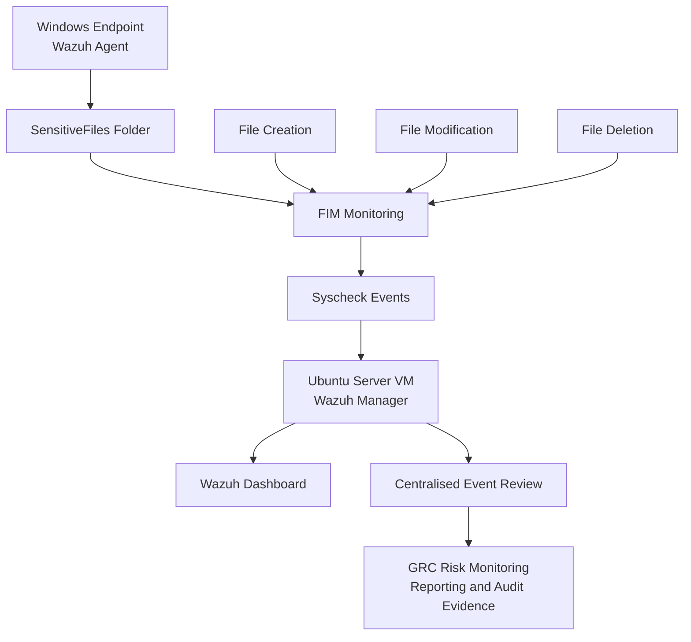

# GRC103 – Practical Risk Monitoring with Wazuh
## Module 4: Risk Monitoring and Reporting
### Lab 1 – File Integrity Monitoring (FIM) Implementation and Control Verification

**International Cybersecurity and Digital Forensics Academy (ICDFA)**

---

## Project Overview

This project documents the practical implementation and GRC evaluation of File Integrity Monitoring (FIM) using the Wazuh security monitoring platform.

The laboratory focuses on monitoring sensitive financial forecast documents stored on a Windows endpoint. The objective is to implement a detective security control capable of identifying file creation, modification and deletion activities, forwarding relevant events to a central monitoring platform and providing evidence that can support security investigations, risk monitoring, management reporting and audit activities.

The laboratory uses an Ubuntu Server virtual machine to host the Wazuh monitoring platform and a Windows endpoint running the Wazuh Agent.

The Wazuh Agent is configured to monitor a designated `SensitiveFiles` directory in real time. Controlled file activities are then used to evaluate whether Wazuh generates the expected File Integrity Monitoring events.

This project approaches the exercise from the perspective of a **GRC Analyst**, connecting technical security monitoring with risk treatment, control verification, governance, auditability and management reporting.

---

## Student Information

| Field | Details |
|---|---|
| Student | Olubunmi Adesanmi |
| Registration Number | C11/CGRCE/26/17550 |
| Academy | International Cybersecurity and Digital Forensics Academy |
| Course | GRC103 – Risk Assessment and Management Techniques |
| Module | Module 4 – Risk Monitoring and Reporting |
| Laboratory | Lab 1 – Practical Risk Monitoring with Wazuh |
| Role | GRC Analyst |
| Submission Date | 22 November 2026 |
| Report Version | 1.0 |

---

## Business Scenario

An organisation has identified a risk involving unauthorised modification or deletion of sensitive financial forecast documents stored on a Windows workstation.

Financial forecasts support important business activities, including:

- Budget preparation and financial planning.
- Cash-flow forecasting.
- Resource allocation.
- Investment and business decisions.
- Management reporting.

Unauthorised changes to these documents could compromise the integrity, accuracy and availability of information used by management.

The organisation therefore requires a detective monitoring control that can identify changes to designated financial documents, generate security events and provide centralised evidence for investigation.

### Risk Statement

If an unauthorised user or process modifies or deletes financial forecast documents on a key workstation, the organisation may make decisions using inaccurate information, lose access to important records, experience financial losses and face operational, reputational or compliance consequences.

### Risk Treatment

Implement File Integrity Monitoring through Wazuh to monitor a designated Windows directory and centrally record file-change events.

---

## Project Objectives

The practical aims to demonstrate the following:

1. Deploy the Wazuh monitoring platform on an Ubuntu Server virtual machine.
2. Access the Wazuh Dashboard through a web browser.
3. Install and register a Wazuh Agent on a Windows endpoint.
4. Configure real-time File Integrity Monitoring for a designated folder.
5. Generate controlled file creation, modification and deletion activities.
6. Review and verify corresponding `syscheck` events in the Wazuh Dashboard.
7. Evaluate the detective control from a GRC perspective.
8. Identify complementary preventive and corrective controls.
9. Define management metrics for ongoing risk monitoring.
10. Demonstrate how centralised monitoring supports governance, accountability and audit evidence.

---

## Laboratory Architecture

The laboratory follows a manager-agent monitoring architecture.



### Environment Components

| Component | Platform | Purpose |
|---|---|---|
| Wazuh Manager | Ubuntu Server VM | Receives and processes monitoring events. |
| Wazuh Dashboard | Ubuntu Server VM | Provides a central interface for reviewing security events. |
| Wazuh Agent | Windows endpoint | Monitors the designated directory and forwards events. |
| SensitiveFiles | Windows endpoint | Contains dummy files for controlled testing. |
| VirtualBox | Host computer | Provides the virtualised Ubuntu environment. |

**Network configuration:** Bridged Adapter, as specified in the instructor-provided laboratory brief. Actual network settings and connectivity must be verified and recorded.

---

## Tools and Technologies

| Tool / Technology | Purpose |
|---|---|
| Oracle VirtualBox | Virtualisation platform |
| Ubuntu Server | Wazuh monitoring server |
| Wazuh Manager | Central security event management |
| Wazuh Dashboard | Security event visualisation and investigation |
| Wazuh Windows Agent | Endpoint monitoring |
| Windows OS | Endpoint hosting the monitored directory |
| File Integrity Monitoring | Detects monitored file changes |
| PowerShell / Windows File Explorer | Controlled file activities |
| Web Browser | Accessing the Wazuh Dashboard |

### Software Versions

| Component | Version |
|---|---|
| Ubuntu Server | To be completed from lab |
| Wazuh Manager | To be completed from lab |
| Wazuh Dashboard | To be completed from lab |
| Wazuh Windows Agent | To be completed from lab |
| VirtualBox | To be completed from lab |
| Windows | To be completed from lab |

---

## Practical Implementation

### Part 1 – Wazuh Manager Deployment

The Wazuh monitoring platform is deployed on the Ubuntu Server virtual machine using the installation resources specified in the instructor brief.

The laboratory uses the Wazuh all-in-one installation approach.

The manager service is verified using:

```bash
sudo systemctl status wazuh-manager
```

The actual installation result and service status must be supported by laboratory evidence.

### Part 2 – Wazuh Dashboard Access

The Ubuntu VM IP address is identified and used to access the Wazuh Dashboard through a web browser.

```text
https://<UBUNTU_VM_IP_ADDRESS>
```

The dashboard is accessed using the installation-generated administrator credentials.

Passwords and other authentication secrets must not be included in screenshots or documentation.

### Part 3 – Windows Agent Installation

The Wazuh Windows Agent is installed on the Windows endpoint.

The instructor brief specifies the following installer:

https://packages.wazuh.com/4.x/windows/wazuh-agent-4.12.0-1.msi

### Part 4 – Agent Registration

The Windows Agent is registered with the Ubuntu-hosted Wazuh Manager.

Agent connectivity is checked through:

**Wazuh Dashboard → Agents**

The actual agent status must be documented using the dashboard evidence.

### Part 5 – File Integrity Monitoring Configuration

The Windows Agent configuration file is:

```text
C:\Program Files (x86)\ossec-agent\ossec.conf
```

A real-time monitoring entry is configured inside the existing `<syscheck>` section.

Example:

```xml
<syscheck>
    <directories realtime="yes">C:\Users\YOUR_WINDOWS_USERNAME\SensitiveFiles</directories>
</syscheck>
```

The username and monitored folder path must be replaced with the actual Windows endpoint details.

The agent is restarted after configuration changes.

### Part 6 – Controlled FIM Testing

A dummy document named:

```text
Q4_Financial_Forecast.docx
```

is used to perform three controlled activities.

| Test ID | Activity | Expected Monitoring Event |
|---|---|---|
| FIM-01 | Create the dummy document | File added / created |
| FIM-02 | Modify and save the document | File modified |
| FIM-03 | Delete the document | File deleted |

The generated events are reviewed in the Wazuh Dashboard.

Only events observed in the actual laboratory are recorded as successful test results.

---

## Control Verification

The practical uses three controlled tests to assess whether the configured FIM control detects the expected file activities.

| Test ID | Control Test | Expected Evidence | Actual Status |
|---|---|---|---|
| FIM-01 | File creation | Syscheck event identifying the new file | Pending verification |
| FIM-02 | File modification | Syscheck event showing a modification | Pending verification |
| FIM-03 | File deletion | Syscheck event identifying the deleted file | Pending verification |

### Evidence Requirements

| Evidence ID | Evidence Description |
|---|---|
| E-01 | Ubuntu dashboard access |
| E-02 | Wazuh version and manager service status |
| E-03 | Windows Agent registration and Active status |
| E-04 | FIM configuration and monitored directory |
| E-05 | File creation alert |
| E-06 | File modification alert |
| E-07 | File deletion alert |
| E-08 | Timestamped test log and syscheck event review |

Evidence filenames should follow the naming structure in the full report.

---

## GRC Analysis

The project examines File Integrity Monitoring as a detective control within the wider risk management lifecycle.

### 1. Risk Identification and Business Impact

Unauthorised modification or deletion of financial documents may affect:

- Financial accuracy and decision-making.
- Business operations and reporting.
- Stakeholder confidence.
- Governance and compliance.
- Auditability and record reliability.

### 2. Risk Monitoring

FIM events provide monitoring information that can help identify unusual file activity, understand event frequency and support investigation.

However, the number of alerts must not automatically be interpreted as the number of security incidents. Each event requires validation against approved changes, business-owner confirmation and relevant access records.

### 3. Preventive Controls

Recommended complementary controls include:

- Role-Based Access Control (RBAC).
- Least-privilege permissions.
- Multi-factor authentication.
- Formal change-approval procedures.
- Periodic access reviews.
- Protected backups and version history.

### 4. Corrective Controls

Where an unauthorised modification is confirmed, the organisation should:

- Preserve the relevant alert and supporting evidence.
- Validate the activity and identify the responsible owner.
- Escalate the incident to the appropriate team.
- Restrict inappropriate access where necessary.
- Investigate the endpoint.
- Restore a verified clean version when required.
- Document the incident and corrective actions.

### 5. Management Metrics

The practical identifies three principal management metrics:

| Metric | Purpose |
|---|---|
| FIM Event Volume and Trend | Measures monitored file-change activity over time. |
| Monitoring Coverage and Agent Health | Measures endpoint monitoring availability and coverage. |
| Unapproved Events and Response Performance | Measures confirmed inappropriate activity and investigation performance. |

---

## Control Effectiveness Considerations

Wazuh FIM is a detective control. It provides visibility into monitored file changes but does not independently prevent those changes.

The overall control assessment must consider:

- Successful manager deployment.
- Dashboard availability.
- Agent registration and connectivity.
- Correct monitoring configuration.
- Successful detection of all three test activities.
- Quality and completeness of generated events.
- Monitoring coverage and retention.
- Documented alert investigation and escalation.

The final control rating must be based on actual laboratory evidence.

**Final control rating:** To be completed after testing.

---

## Repository Structure

Recommended repository layout:

```text
GRC103-Module-4-Wazuh-FIM/
│
├── README.md
│
├── REPORT.md
│
├── evidence/
│   ├── E01_Ubuntu_Dashboard.png
│   ├── E02_Wazuh_Version_Service.png
│   ├── E03_Windows_Agent_Active.png
│   ├── E04_FIM_Configuration.png
│   ├── E05_File_Created_Alert.png
│   ├── E06_File_Modified_Alert.png
│   ├── E07_File_Deleted_Alert.png
│   └── E08_Test_Log_and_Syscheck_Filter.png
│
└── notes/
    └── lab-observations.md
```

Evidence should be added only after it has been captured from the actual laboratory environment.

Do not upload passwords, agent registration keys, private credentials or confidential business information.

---

## Key Learning Outcomes

Through this practical, the GRC Analyst demonstrates an understanding of:

1. Implementing a technical detective control to address an identified business risk.
2. Connecting endpoint monitoring with enterprise risk management.
3. Verifying control implementation through controlled testing.
4. Interpreting technical alerts as potential indicators requiring investigation.
5. Distinguishing preventive, detective and corrective security controls.
6. Using monitoring data to support management reporting.
7. Maintaining evidence for audit and compliance purposes.
8. Communicating control limitations and residual risk.

---

## References and Learning Resources

1. International Cybersecurity and Digital Forensics Academy. (n.d.). *GRC103 – Risk Assessment and Management Techniques, Module 4: Risk Monitoring and Reporting, Lab 1.*

2. Wazuh Documentation – File Integrity Monitoring, Basic Settings:  
   https://documentation.wazuh.com/4.12/user-manual/capabilities/file-integrity/basic-settings.html

3. Wazuh Documentation – Installation Assistant:  
   https://documentation.wazuh.com/4.12/installation-guide/wazuh-server/installation-assistant.html

4. Wazuh Windows Agent Installer:  
   https://packages.wazuh.com/4.x/windows/wazuh-agent-4.12.0-1.msi

5. Wazuh Installation Script:  
   https://packages.wazuh.com/4.12/wazuh-install.sh

---

## AI Usage Declaration

ChatGPT, developed by OpenAI, was used as a supporting tool during the preparation of this project.

Its assistance included report organisation, technical concept clarification, improving the written presentation and structuring the documentation.

ChatGPT was not used to execute the practical laboratory activities, configure the Wazuh environment, generate actual FIM events, capture screenshots or verify the laboratory results.

The student is responsible for reviewing the content, validating technical information and ensuring that all submitted laboratory evidence accurately reflects the work performed.

---

## Conclusion

This project demonstrates how File Integrity Monitoring can support risk monitoring, security visibility and governance through the detection and centralisation of file-change events.

By connecting Wazuh technical capabilities with a defined business risk, the practical demonstrates the importance of control implementation, verification, monitoring evidence, management metrics and continuous risk treatment.

The exercise reinforces that effective cybersecurity governance requires more than deploying technical tools. It also requires ownership, accountability, investigation procedures, preventive safeguards, corrective actions and reliable evidence.

**Project:** GRC103 – Module 4 – Lab 1  
**Author:** Olubunmi Adesanmi  
**Role:** GRC Analyst
